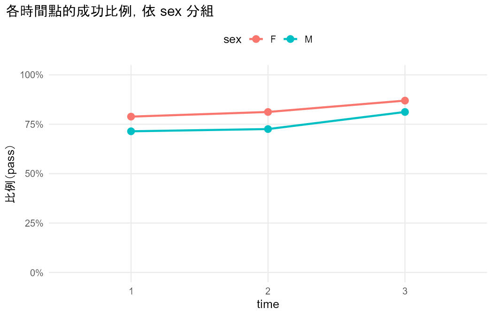

```{r}
#| include: false
suppressPackageStartupMessages({ library(lme4); library(knitr) })
engine <- "categorical-correlated/R"
for (f in c("utils.R", setdiff(list.files(engine, pattern = "\\.R$"), "utils.R"))) source(file.path(engine, f), encoding = "UTF-8")
source("dev/textbook_data.R")
square_to_wide <- function(tab) {
  idx <- which(tab > 0, arr.ind = TRUE)
  data.frame(y1 = rownames(tab)[rep(idx[, 1], tab[idx])], y2 = colnames(tab)[rep(idx[, 2], tab[idx])])
}
f3 <- function(x) formatC(x, digits = 3, format = "f")
pv <- function(p) if (p < 0.001) "< 0.001" else paste("=", formatC(p, digits = 3, format = "f"))
est_of <- function(r, m, col = "estimate") r$estimates[r$estimates$measure == m, col]
tst <- function(r, pat, col = "statistic") r$tests[grepl(pat, r$tests$test, fixed = TRUE), col][1]
```

# 為什麼要有 Part 3？

Part 1（關聯分析）與 Part 2（類別模型）的方法都假設**每一列是不同、彼此獨立的個體**（§1.1.3）。實際資料常常不是這樣：

| 情況 | 例子 | 課本 |
|---|---|---|
| **配對** | 同一位學生回答「平日」與「週末」喝酒程度；前測與後測 | 第 8 章 |
| **重複測量** | 同一位學生三次考試的成績 | 第 9–10 章 |
| **叢集** | 同一個家庭的小孩、同一所學校的學生 | 第 9–10 章 |

這時候把資料當成獨立會怎樣？**估計值通常沒問題，標準誤（SE）是錯的**（第 8 章開頭）。同一個人的回答通常**正相關**，後果有兩個方向（§9.2.3）：

- **叢集間**的效果（性別、處理組：同一個人身上不會變）：真正的 SE 比當成獨立時**大**，忽略相關會**高估**顯著性。
- **叢集內**的效果（時間、情境：同一個人身上會變）：真正的 SE 比當成獨立時**小**，忽略相關會**低估**顯著性。

三個 Part 的分工：

| | 資料獨立 | 資料不獨立 |
|---|---|---|
| **只比較分布／有沒有差異** | Part 1：卡方、Fisher、勝算比（Ch.2） | **Part 3**：McNemar、邊際同質性（Ch.8） |
| **建模型、有解釋變數** | Part 2：logistic、多類別 logit（Ch.4–6） | **Part 3**：GEE（Ch.9）、GLMM（Ch.10） |

# 配對資料：比較兩次的分布（第 8 章）

同一批人被測量兩次、類別相同時，資料可以整理成方陣：列是第一次、欄是第二次。對角線上是兩次相同的人，對角線外是「改變」的人。

## 二元：McNemar 檢定（§8.1）

```{r}
r81 <- cc_paired_binary(square_to_wide(tab_8_1), "y1", "y2", success = "yes")
```

**問題**：同一批人兩次的「成功」比例是否相同？

- **H₀（邊際同質性）**：P(Y₁ = 1) = P(Y₂ = 1)，等價於 π₁₂ = π₂₁。
- **統計量**：z = (n₁₂ − n₂₁)/√(n₁₂ + n₂₁)，z² ~ χ²₁。**只用到改變的人**（n₁₂、n₂₁）；兩次相同的人不影響檢定。
- **條件**：n₁₂ + n₂₁ > 10 時常態近似才可靠，否則用精確二項檢定（§8.1.1）。

**課本例題（Table 8.1）**：1144 人被問「願不願意為環境付較高的稅」與「願不願意降低生活水準」。

```{r}
kable(as.data.frame.matrix(r81$tables$counts), caption = "Table 8.1（列 = 付較高的稅，欄 = 降低生活水準）")
```

- McNemar X² = `r f3(tst(r81, "McNemar"))`（df = 1），P `r pv(tst(r81, "McNemar", "p_value"))`：證據不足，無法確定兩題的「願意」比例不同。
- 比例差 `r f3(est_of(r81, "Difference of proportions (y1 - y2)"))`，95% score 信賴區間 `r f3(est_of(r81, "Difference of proportions (y1 - y2)", "lower"))` 到 `r f3(est_of(r81, "Difference of proportions (y1 - y2)", "upper"))`。
- 兩種勝算比（下一節會說明差別）：邊際勝算比 `r f3(est_of(r81, "Marginal odds ratio y1 vs y2 (population-averaged)"))`、條件勝算比 n₁₂/n₂₁ = `r f3(est_of(r81, "Conditional odds ratio n12/n21: y1 vs y2 (subject-specific)"))`。

以上數字都和課本一致（課本：X² = 2.62、P = 0.106、CI (−0.005, 0.048)、1.11、1.23）。

```{r}
#| eval: false
#| code-summary: "R code — McNemar（點開查看）"
tab <- matrix(c(227, 107, 132, 678), 2)
mcnemar.test(tab, correct = FALSE)                   # 課本不用連續性校正
PropCIs::scoreci.mp(tab[2, 1], tab[1, 2], sum(tab), 0.95)   # 比例差的 score 信賴區間
tab[1, 2] / tab[2, 1]                                 # 條件勝算比
```

## 名目：邊際同質性（§8.3）

```{r}
r85 <- cc_paired_nominal(square_to_wide(tab_8_5), "y1", "y2", levels = rownames(tab_8_5))
```

類別超過 2 個時，邊際同質性是「**每一類**的兩次比例都相同」。本 Skill 用**對稱 vs 準對稱模型的概似比檢定**（§8.3.4）：

- 對稱模型：πᵢⱼ = πⱼᵢ（對角線兩側鏡像）。
- 準對稱模型：log(πᵢⱼ/πⱼᵢ) = βᵢ − βⱼ，允許邊際不同。
- 在準對稱模型下，「邊際同質」等於「對稱」，所以兩個模型的 deviance 差就是邊際同質性的檢定，df = c − 1。

**課本例題（Table 8.5）**：541 位咖啡購買者兩次買的品牌。LR = `r f3(tst(r85, "symmetry vs quasi"))`（df = `r tst(r85, "symmetry vs quasi", "df")`），P `r pv(tst(r85, "symmetry vs quasi", "p_value"))`；CMH 檢定 = `r f3(tst(r85, "CMH"))`，結論相同（課本 12.50、P = 0.014；CMH 12.29）。

整體顯著後，再看是哪一類改變（§8.3.2）：

```{r}
e <- r85$estimates
kable(data.frame(品牌 = e$category, 第一次 = f3(e$prop_1), 第二次 = f3(e$prop_2), 差 = f3(e$difference),
                 `95% CI` = paste0("(", f3(e$lower), ", ", f3(e$upper), ")"), P = vapply(e$p_value, pv, ""),
                 check.names = FALSE), caption = "各品牌「該類 vs 其他」的追蹤比較（沒有多重比較校正，只用來描述）")
```

High Point 下降、Sanka 上升，其他品牌沒有明顯改變。

## 有序：累積 logit 邊際模型（§8.4）

```{r}
r86 <- cc_paired_ordinal(square_to_wide(tab_8_6), "y1", "y2", levels = rownames(tab_8_6))
b86 <- est_of(r86, "beta: cumulative logit, first vs second (logit P(Y <= j))")
```

類別有順序時，問題變成「第二次是否**整體偏高或偏低**」：

$$\text{logit}\,P(Y_1 \le j) = \alpha_j + \beta, \qquad \text{logit}\,P(Y_2 \le j) = \alpha_j$$

所有切點共用 β（比例勝算），檢定 H₀: β = 0 只用 **1 個自由度**；名目方法用 c − 1 個。真的有「整體偏移」時，有序方法的檢定力高得多（§8.4）。

**課本例題（Table 8.6）**：1230 人「多常回收」與「多常少開車」（always < often < sometimes < never）。β̂ = `r f3(b86)`（robust SE `r f3(est_of(r86, "beta: cumulative logit, first vs second (logit P(Y <= j))", "se"))`），和課本的 2.754（0.081）一致：回收的回答明顯偏向「always」那一端。

# 核心觀念：「整體平均」與「同一個人」

這是 Part 3 最重要、也最容易說錯的地方（§8.2、§9.1、§10.1.4）。同一個效果有兩種問法：

| | 邊際模型（marginal） | 個體模型（subject-specific） |
|---|---|---|
| 問題 | **整體來說**，第三次考試的及格勝算是第一次的幾倍？ | **對同一位學生**，第三次的及格勝算是第一次的幾倍？ |
| 模型 | logit P(Yₜ = 1) = α + βₜ | logit P(Yᵢₜ = 1) = uᵢ + α + βₜ，uᵢ ~ N(0, σ²) |
| 配適 | GEE（第 9 章） | GLMM（第 10 章） |

在邏輯連結下，**個體模型的效果通常比較大**。下圖說明原因（示意圖，參數是自己設定的：β = 1、σ = 2）：每個人有自己的 S 形曲線（灰線），把所有人的機率平均起來（藍線），曲線變得比較平，所以整體平均的效果比每個人的效果小。個體差異 σ 越大，兩者差越多。

```{r}
#| fig-width: 7
#| fig-height: 4
x <- seq(-6, 6, length.out = 200)
u <- qnorm(seq(0.05, 0.95, length.out = 9), sd = 2)
plot(NA, xlim = range(x), ylim = c(0, 1), xlab = "x", ylab = "P(Y = 1)", las = 1,
     main = "個體的曲線（灰）與整體平均的曲線（藍）")
for (ui in u) lines(x, plogis(ui + x), col = "grey70")
average_curve <- function(x) sapply(x, function(xx) integrate(function(z) plogis(z + xx) * dnorm(z, sd = 2), -Inf, Inf)$value)
lines(x, average_curve(x), col = "#3b82f6", lwd = 3)
```

所以 GEE 和 GLMM 的數字不同時，**不是其中一個算錯，而是回答不同的問題**。下一節的課本例子就是這樣。

# GEE：邊際模型（第 9 章）

```{r}
ab <- abortion_long(); ab$situation <- factor(ab$situation, levels = c(3, 1, 2))
g_ind <- cc_gee_binary(ab, "person", "response", x = "gender", time = "situation", numeric = "gender",
                       success = "1", corstr = "independence")
g_exc <- cc_gee_binary(ab, "person", "response", x = "gender", time = "situation", numeric = "gender",
                       success = "1", corstr = "exchangeable")
naive <- summary(glm(response ~ situation + gender, binomial, data = ab))$coefficients
```

GEE（generalized estimating equations，§9.2.2）的步驟：

1. 指定邊際模型（例如 logit 連結與解釋變數）。
2. 指定變異數與平均數的關係（二元資料用二項分配）。
3. 猜一個 **working correlation**：同一個人不同次的相關長什麼樣子。課本建議沒有特別理由時用 **exchangeable**（每一對相關都相同）。
4. 解估計方程式得到估計值。
5. 用資料實際的變異，把 SE 調整成 **robust（sandwich）SE**：**即使 working correlation 猜錯，robust SE 仍然有效**。

**課本例題（Table 9.1）**：1850 人在三種情境下是否支持墮胎合法化（情境 3 為參考組）。

```{r}
e1 <- g_ind$estimates; e2 <- g_exc$estimates
kable(data.frame(效果 = c("情境 1 vs 3（叢集內）", "性別（叢集間）"),
                 估計值 = f3(e2$estimate[e2$term %in% c("situation1", "gender")]),
                 `當成獨立的 SE` = f3(naive[c("situation1", "gender"), 2]),
                 `robust SE` = f3(e2$se[e2$term %in% c("situation1", "gender")]), check.names = FALSE),
      caption = "GEE（exchangeable）的估計值與 SE")
```

- 情境（叢集內）的 robust SE 比當成獨立時**小**，性別（叢集間）的**大**，正好是第 1 節說的兩個方向。
- exchangeable working correlation 估計的相關 ρ̂ = `r f3(g_exc$notes$working_correlation)`：同一個人三種情境的回答非常一致。
- 情境的整體 Wald 檢定 = `r f3(tst(g_exc, "situation"))`（df = 2），和課本的 26.02 一致。

**GEE 的限制**（§9.2.4）：GEE 沒有寫出完整的機率分配，所以**沒有概似函數**，不能做概似比檢定、不能比較 deviance 或 AIC，推論一律用 robust SE 的 Wald 檢定；robust SE 是大樣本方法，叢集少時傾向低估。

```{r}
#| eval: false
#| code-summary: "R code — GEE（點開查看）"
library(geepack)
fit <- geeglm(response ~ factor(situation) + gender, id = person, family = binomial,
              corstr = "exchangeable", data = Abortion)      # 同一個 id 的資料要排在一起
summary(fit)                                              # Std.err 就是 robust SE
anova(fit)                                                # Wald 檢定
```

# GLMM：隨機效果模型（第 10 章）

```{r}
cmp <-cc_compare_gee_glmm(ab, "person", "response", x = "gender", time = "situation", numeric = "gender",
                           success = "1", nagq = 100)
```

GLMM 在模型裡給每個叢集一個**隨機截距** uᵢ ~ N(0, σ²)（§10.1.1）：

- σ 描述叢集之間差多少；σ 越大，同一個叢集內的回答越像。
- 效果是「**固定同一個叢集**」時的效果（個體層次）。
- GLMM 有概似函數，可以用概似比檢定；但概似函數要用數值積分近似，**積分點數要夠多**（§10.1.5）。
- 檢定 σ = 0 時，σ 不能為負，H₀ 在參數空間的邊界，**P 值要取 χ²₁ 右尾機率的一半**（§10.1.6）。

**課本例題（Table 10.3）**：同一份墮胎意見資料，GEE 與 GLMM 並排。

```{r}
e <- cmp$estimates[cmp$estimates$term != "(Intercept)", ]
kable(data.frame(效果 = c("情境 1 vs 3", "情境 2 vs 3", "性別"),
                 `GLMM（同一個人）` = paste0(f3(e$glmm_estimate), "（", f3(e$glmm_se), "）"),
                 `GEE（整體平均）` = paste0(f3(e$gee_estimate), "（", f3(e$gee_se), "）"),
                 `GLMM / GEE` = formatC(e$ratio, digits = 1, format = "f"), check.names = FALSE),
      caption = "估計值（SE）")
```

- GLMM 的估計值約為 GEE 的 5–6 倍，**SE 也一樣大**，所以兩者的結論相同。
- 原因：σ̂ = `r f3(cmp$notes$glmm$notes$sigma)`，個體差異極大；1850 人中有 `r formatC(100 * cmp$notes$glmm$notes$all_same_share, digits = 1, format = "f")`% 三種情境的回答完全相同。
- 這正是第 3 節的圖：個體差異越大，整體平均的效果越接近 0。

**積分點數真的要夠**：這個例子用 25 個點時 σ̂ 是 9.34，要到 100 個點才是課本的 8.75。本 Skill 每次用 50 點與 100 點各配適一次，差異超過 0.0005 就提出警告（`QUADRATURE_UNSTABLE`）。

**怎麼選**（§10.2.5）：主要比較的是**不同群體**（叢集間變數）→ GEE 比較直接；主要看**同一個人的變化**（叢集內變數），或想估計每個叢集自己的值 → GLMM；不確定時兩個都做並排。

```{r}
#| eval: false
#| code-summary: "R code — GLMM（點開查看）"
library(lme4)
fit <- glmer(response ~ (1 | person) + factor(situation) + gender, family = binomial,
             nAGQ = 100, data = Abortion)                 # nAGQ：積分點數，要確認夠多
summary(fit)                                              # Random effects 的 Std.Dev. = σ̂
fit0 <- glm(response ~ factor(situation) + gender, binomial, data = Abortion)
lr <- 2 * (as.numeric(logLik(fit)) - as.numeric(logLik(fit0)))
0.5 * pchisq(lr, 1, lower.tail = FALSE)                   # σ = 0 的檢定：P 取一半
```

# 怎麼選方法？

```{mermaid}
flowchart TD
  Q0{"同一個人（或同一群）<br/>有多筆資料嗎？"} -->|否| P12["Part 1 / Part 2"]
  Q0 -->|是| Q2{"只比較兩次的分布？<br/>（沒有解釋變數、剛好 2 次）"}
  Q2 -->|是| T{"結果的型態"}
  T -->|二元| A1["McNemar<br/>§8.1"]
  T -->|名目| A2["邊際同質性<br/>§8.3"]
  T -->|有序| A3["累積 logit 邊際模型<br/>§8.4"]
  Q2 -->|否| Q3{"要哪一種效果？"}
  Q3 -->|整體平均| B1["GEE<br/>§9.2–9.3"]
  Q3 -->|同一個人| B3["GLMM<br/>§10.1–10.2"]
  Q3 -->|兩者| B4["GEE 與 GLMM 並排<br/>§10.1.4"]
```

# Skill 介紹：categorical-correlated

## 這個 Skill 做什麼？

使用者給一份資料，Skill 從資料總覽開始，一步一步分析下去。**每一步做完都向使用者報告結果並建議下一步，要做什麼由使用者決定**；使用者說「結束」時，Skill 把整個過程整理成一份報告。

```{mermaid}
flowchart TD
  S1["1 資料總覽<br/>找出可能不獨立的線索"] --> S2["2 確認清單<br/>資料結構、變數型態、設定"]
  S2 --> S3["3 依問題畫圖"] --> S4["4 判斷適不適合<br/>✅ / ⚠️ / ❌"]
  S4 -->|使用者 OK| S5["5 計算（R）"]
  S5 --> S6["6 白話解釋結果"] --> S7{"7 建議下一步<br/>（最多 3 個＋結束）"}
  S7 -->|使用者選一個| S7a["7a 簡短確認<br/>只列改變的設定"] -->|使用者 OK| S5
  S7 -->|使用者選結束| S8["8 整份分析報告<br/>（Quarto HTML）"]
```

| 階段 | Skill 做什麼 | 誰決定 |
|---|---|---|
| 1–4 | 資料總覽、確認清單、畫圖、判斷適不適合；整個分析只做一次 | 使用者確認資料結構與設定 |
| 5–6 | 程式計算，Claude 用固定段落解釋 | — |
| 7 | 依課本建議下一步，每個附理由與節號 | **使用者選擇**（或自己提出） |
| 7a | 只列和上一步不同的設定，再判斷一次適不適合 | 使用者確認 |
| 8 | 程式把每一步的結果、建議與選擇合成一份報告 | 使用者決定何時結束 |

建議下一步的依據寫在 `references/decision-tree.md`，例如：McNemar 只能比兩次、不能加解釋變數 → 建議 GEE（§8.1 → §9.2）；GEE 做完、也想知道同一個人的效果 → 建議和 GLMM 並排（§10.1.4）。**建議不只看 P 值**；「整體平均或同一個人」由使用者的問題決定。

四條不能違反的規則：

1. **所有數字都由程式計算**；換方向（取倒數）、加總也算計算，Claude 不可以自己做。
2. **資料結構一定要和使用者確認**：哪些列屬於同一個人，資料本身無法證明。
3. **先判斷適不適合，再停下來等使用者 OK**。
4. **分清楚兩種效果**：GEE 一律說「整體來說」，GLMM 一律說「對同一個人」；數字不同時不可以說其中一個算錯。

## 丟資料進去之後，AI 怎麼想、會問什麼？

下圖是 Skill 收到資料後的決策樹。**菱形是 AI 自己依程式輸出與課本判斷的地方，黃色是 AI 一定要停下來問使用者的地方**；資料本身無法證明的事（哪些列是同一個人、數字代碼有沒有順序、要哪一種效果），AI 不可以自己假設。

```{mermaid}
flowchart TD
  IN(["使用者：資料檔＋問題"]) --> P1["階段 1：程式做資料總覽<br/>變數型態、缺失、類別次數"]
  P1 --> H{"有沒有不獨立的線索？<br/>重複的 id、G1／G2／G3、Dalc／Walc"}
  H -->|有：逐條列出| AQ
  H -->|沒有：提醒沒偵測到不代表獨立| AQ
  AQ[/"問：你想回答什麼問題？<br/>（一開始就說了就跳過）"/]
  AQ --> C0
  subgraph S2 [" "]
    C0[/"<b>階段 2：確認清單（一則訊息問完）</b><br/>① 資料真的不獨立嗎？叢集單位是什麼？"/]
    C0 -->|是| C1[/"② 哪幾欄要合併、時間怎麼編號"/]
    C1 --> C3[/"③ 結果是二元／名目／有序？<br/>數字代碼的順序；要切分時的門檻"/]
    C3 --> Q2{"④ 只比兩次、<br/>沒有解釋變數？"}
    Q2 -->|否| C6[/"⑤ 解釋變數、參考組<br/>⑥ 要整體平均，還是同一個人的效果？"/]
  end
  C0 -->|否| R1["轉介 Part 1／Part 2"]
  Q2 -->|是| M["配對比較，依結果型態<br/>二元：McNemar §8.1<br/>名目：邊際同質性 §8.3<br/>有序：累積 logit §8.4"]
  C6 --> G["依要的效果<br/>整體平均：GEE §9.2–9.3<br/>同一個人：GLMM §10.1–10.2<br/>兩者：並排 §10.1.4"]
  M --> P3["階段 3：依問題畫圖、算重點數字"]
  G --> P3
  P3 --> J{"階段 4：適不適合？<br/>對照注意事項清單 ✅／⚠️／❌"}
  J --> A4[/"問：用推薦的方法嗎？"/]
  A4 -->|OK| P5["階段 5–6：程式計算，AI 白話解釋"]
  P5 --> N{"階段 7：依課本，下一步可以做什麼？<br/>最多 3 個，各附理由與節號"}
  N --> A7[/"問：要做哪一個？或結束"/]
  A7 -->|只換方法、解釋變數| A7a[/"7a 問：只改這些設定，OK 嗎？"/]
  A7a -->|OK| P5
  A7 -->|改結果變數、叢集單位、門檻| C0
  A7 -->|結束| P8["階段 8：整份分析報告"]
  classDef ask fill:#fff3cd,stroke:#c99a00,color:#222
  class AQ,C0,C1,C3,C6,A4,A7,A7a ask
  style S2 fill:#f3f6fa,stroke:#7a8ca3,color:#222
```

AI 停下來的地方、它依據什麼、會問什麼：

| 階段 | AI 依據什麼想 | AI 會問你 | 例如你可以回答 |
|---|---|---|---|
| 1 資料總覽 | 程式找出的線索（`profile.json`） | 你想用這份資料回答什麼問題？ | 三次考試的及格率有沒有改變？和性別有關嗎？ |
| 2 確認清單 | 決策樹 Q0–Q3（`references/decision-tree.md`） | ①–⑧ 每一項設定，附預設值與理由 | 「照預設」，或「③ 10 分以上算及格」 |
| 4 適不適合 | 注意事項清單（`references/checklist.md`）與圖表的數字 | 推薦的方法 ✅／⚠️／❌，用推薦的嗎？ | 「用推薦的」 |
| 7 下一步 | 決策樹 Q4：這一步的結果、你的問題、課本 | 最多 3 個建議＋結束，要做哪一個？ | 「選 1」、「結束」，或自己提出 |
| 7a 簡短確認 | 和上一步比，改了哪些設定 | 只改這些，OK 嗎？ | 「照建議」 |

## 怎麼開始：第一個指令

示範資料放在 `data/` 資料夾（`data/student_por.csv`，欄位說明見 `data/README.md`）。安裝好 Skill 之後，在 Part3 資料夾開啟 Claude Code，輸入：

```text
請用 categorical-correlated skill 分析 data/student_por.csv：學生三次考試的及格率有沒有改變？和性別有關嗎？
```

在 claude.ai 網頁版則先上傳 `student_por.csv`，指令改成「分析 student_por.csv」。這一句就是下一章示範的起點：AI 會先給資料總覽，再用確認清單問你上圖黃色的問題，之後每一步都由你決定。Skill 的輸出寫在 `data/output/`。

## 涵蓋的方法

| 情境 | 方法 | `analysis` |
|---|---|---|
| 兩次測量，二元 | McNemar＋相依比例差的 score 信賴區間 | `paired_binary` |
| 兩次測量，名目 | 邊際同質性（對稱 vs 準對稱 LR）＋逐類別追蹤 | `paired_nominal` |
| 兩次測量，有序 | 累積 logit 邊際模型（GEE）＋有序準對稱 | `paired_ordinal` |
| 有解釋變數，二元，整體平均 | 邊際 logistic（GEE） | `gee_binary` |
| 有解釋變數，有序／名目 | 累積 logit／baseline-category logit（GEE） | `gee_ordinal`、`gee_nominal` |
| 有解釋變數，二元，同一個人 | 隨機截距 logistic（GLMM） | `glmm_binary` |
| 兩種效果都要 | GEE 與 GLMM 並排 | `compare_gee_glmm` |

## 會偵測什麼、提醒什麼？

- **階段 1 自動找出可能不獨立的線索**：重複的 id、欄名只差編號（`G1`、`G2`、`G3`）、欄名只差第一個字母且類別相同（`Dalc`／`Walc`、`Mjob`／`Fjob`）。線索都要使用者確認。
- **注意事項清單**（20 條、13 個警告代碼）：例如不一致對數 ≤ 10（改用精確檢定）、缺失資料（GEE 需要 MCAR、GLMM 只需要 MAR）、積分點數不穩定、GEE 不能做概似比檢定。課本沒有給門檻的地方（例如「GEE 需要多少叢集」），Skill 不自己訂數字，只報告叢集數並提醒。

# Skill 應用示範：一筆資料的完整分析

```{r}
sw <- "dev/demo/stepwise/output"
slog <- jsonlite::read_json(file.path(sw, "analysis_log.json"))
prof <- jsonlite::read_json(file.path(sw, "profile.json"), simplifyVector = TRUE)
read_lines <- function(p) readLines(p, encoding = "UTF-8", warn = FALSE)
# Lines under a "## " heading of a Skill-generated Markdown file, up to the next "## " heading.
section_of <- function(lines, heading) {
  i <- which(lines == heading)[1]
  if (is.na(i)) return(character())
  j <- which(grepl("^## ", lines) & seq_along(lines) > i)[1]
  lines[(i + 1):(if (is.na(j)) length(lines) else j - 1)]
}
first_look <- read_lines(list.files(sw, "^初步檢視_.*\\.md$", full.names = TRUE)[1])
method_names <- c(paired_binary = "McNemar 檢定（§8.1）", gee_binary = "GEE 邊際 logistic 模型（§9.2）",
                  glmm_binary = "GLMM 隨機截距 logistic（§10.1–10.2）", compare_gee_glmm = "GEE 與 GLMM 並排（§10.1.4）",
                  paired_nominal = "邊際同質性（§8.3）", paired_ordinal = "有序配對累積 logit（§8.4）",
                  gee_ordinal = "GEE 累積 logit（§9.3）", gee_nominal = "GEE baseline-category logit（§9.3）")
mname <- function(a) if (is.null(a)) "—" else method_names[[a]]
```

用一筆資料，從使用者丟出資料開始，走完 Skill 的每一個階段。以下每一段的數字與文字都**直接讀取 Skill 實際產生的檔案**（`dev/demo/stepwise/output/`），不是另外重打的。

::: {.callout-note}
這次示範中「使用者的選擇」由開發者模擬，用來展示流程；Skill 的建議、計算與解釋都是 Skill 產生的。實際使用時，每一個選擇都由使用者決定。
:::

**使用者的問題**：`r slog$question`

## 階段 1：資料總覽

Skill 讀進 `student_por.csv`：`r prof$n_rows` 列、`r prof$n_cols` 欄，每位學生一列。它從欄名與類別找出可能「不獨立」的線索，**每一條都要使用者確認**：

```{r}
h <- prof$structure$hints
kable(data.frame(線索 = c(repeated_wide = "可能是重複測量", possible_matched_pairs_wide = "可能是配對")[h$type],
                 欄位 = vapply(h$columns, paste, "", collapse = "、"), 根據 = h$evidence))
```

使用者確認：`G1`、`G2`、`G3` 是同一位學生的三次成績，要用來回答及格率的問題。

## 階段 2：確認清單

Skill 用一則訊息列出所有設定（附預設值與理由），使用者確認後的結果：

```{r}
#| results: asis
cat(paste0("- ", unlist(slog$settings)), sep = "\n")
```

## 階段 3–4：初步檢視、判斷適不適合

Skill 依確認的設定畫圖、算出重點數字：

```{r}
#| results: asis
cat(section_of(first_look, "## 重點數字"), sep = "\n")
```

{width=80%}

接著 Skill 依注意事項清單判斷方法適不適合，等使用者 OK。使用者決定先看頭尾兩次考試，於是開始第 1 步。

```{r}
#| results: asis
for (k in seq_along(slog$steps)) {
  s <- slog$steps[[k]]
  d <- file.path(sw, s$dir)
  res <- jsonlite::read_json(file.path(d, "result.json"), simplifyVector = TRUE)
  rep_lines <- read_lines(list.files(d, "^分析報告_.*\\.md$", full.names = TRUE)[1])
  cat(sprintf("\n## 第 %d 步：%s\n\n", k, s$question))
  cat(sprintf("**方法**：%s　**為什麼做這一步**：%s\n\n", mname(res$method), s$reason))
  cat("**Skill 的報告**（階段 5–6）：\n\n")
  cat(section_of(rep_lines, "## 結論與解釋"), sep = "\n")
  cat(sprintf("\n\n{width=80%%}\n\n", d, tail(res$plots, 1)))
  cat("**Skill 建議的下一步**（階段 7）：\n\n| # | 建議 | 方法 | 理由 |\n|---|---|---|---|\n")
  for (i in seq_along(s$suggestions)) {
    g <- s$suggestions[[i]]
    cat(sprintf("| %d | %s%s | %s | %s |\n", i, g$text, if (isTRUE(g$recommended)) "（推薦）" else "",
                mname(g$analysis), g$reason))
  }
  cat(sprintf("\n**使用者的選擇**：「%s」\n\n", s$choice))
}
```

## 階段 8：整份分析報告

使用者選「結束」後，Claude 寫好整體結論（`結論.md`），執行 `build_report.R`，產生 `整份分析報告_student_por.html`（單一檔案，用瀏覽器打開）。報告的章節：

```{r}
#| results: asis
qmd_lines <- read_lines(file.path(sw, "整份分析報告_student_por.qmd"))
heads <- grep("^#{1,2} ", qmd_lines, value = TRUE)
heads <- heads[seq_len(which(heads == "# 附錄：重現每一步的程式碼"))]
cat(sub("^## ", "    - ", sub("^# ", "- ", heads)), sep = "\n")
```

報告裡的數字都由程式從各步驟的結果放入；Claude 只寫解釋與結論的文字。最後的結論：

```{r}
#| results: asis
cat(section_of(read_lines(file.path(sw, "結論.md")), "## 研究問題的回答"), sep = "\n")
```

# Skill 的驗證：四個實測問題

```{r}
st_dir <- "dev/skill-test"
judg <- yaml::read_yaml(file.path(st_dir, "judgment.yml"))
v <- jsonlite::read_json(file.path(st_dir, "verify_results.json"), simplifyVector = TRUE)
rd <- function(q) jsonlite::read_json(file.path(st_dir, "outputs", q, "result.json"), simplifyVector = TRUE)
o1 <- rd("q1b"); o2 <- rd("q2"); o3 <- rd("q3b"); o3c <- rd("q3c")
```

## 情境

資料：UCI 葡萄牙高中生資料（`student_por.csv`，649 位學生、一人一列，CC BY 4.0），和 Part 1、Part 2 用同一份。同一份資料裡有好幾種「不獨立」：

- `Dalc`、`Walc`：同一位學生的平日、週末喝酒程度（1–5）→ 有序配對
- `Mjob`、`Fjob`：同一位學生的媽媽、爸爸職業 → 名目配對
- `G1`、`G2`、`G3`：同一位學生三次考試的成績 → 重複測量

實測方法（和組員相同）：

1. **先寫人為判斷**（`judgment.yml`）：依課本決定每題的資料結構與方法，實測前寫好。
2. **每題開一個全新的 Claude 對話**，工作資料夾只有資料檔與 Skill，看不到答案。
3. **獨立驗證**（`verify.R`）：不用 Skill 的程式，直接呼叫 R 套件算出每題的答案，和 Skill 的輸出逐項比對。

## 平日和週末的喝酒程度一樣嗎？

```{r}
b1 <- o1$estimates
```

- Skill 判斷：同一位學生的兩個有序回答 → `paired_ordinal`（✅）；名目方法標 ⚠️（浪費順序資訊）、卡方標 ❌（兩個回答不獨立）。
- 結果：週末落在較高喝酒程度的勝算是平日的 `r f3(b1$estimate[3])` 倍（95% CI `r f3(b1$lower[3])` 到 `r f3(b1$upper[3])`），P `r pv(o1$tests$p_value[1])`。
- 逐人來看：`r o1$tables$changes$n[1]` 人週末比平日高、`r o1$tables$changes$n[2]` 人比平日低、`r o1$tables$changes$n[3]` 人相同。

## 媽媽和爸爸的職業分布不同嗎？

```{r}
e2 <- o2$estimates
```

- Skill 判斷：名目配對 → `paired_nominal`（✅）；兩群獨立樣本的卡方標 ❌。
- 結果：邊際同質性 LR = `r f3(o2$tests$statistic[1])`（df = `r o2$tests$df[1]`），P `r pv(o2$tests$p_value[1])`。媽媽「在家」的比例 `r f3(e2$prop_1[e2$category == "at_home"])`，爸爸只有 `r f3(e2$prop_2[e2$category == "at_home"])`；爸爸「other」較多。

## 三次考試的及格率有變化嗎？和性別有關嗎？

```{r}
e3 <- o3$estimates
k <- function(term, col) e3[e3$term == term, col]
```

這一題測了兩種回答：

- **使用者兩種效果都想知道**（q3b）→ Skill 推薦 `compare_gee_glmm`：

```{r}
kable(data.frame(比較 = c("第 2 次 vs 第 1 次", "第 3 次 vs 第 1 次", "男 vs 女"),
                 `GEE 勝算比（整體來說）` = f3(e3$gee_or[-1]), `GLMM 勝算比（對同一位學生）` = f3(e3$glmm_or[-1]),
                 check.names = FALSE))
```

  `r formatC(100 * v$q3$all_same_share, digits = 1, format = "f")`% 的學生三次結果都相同（σ̂ = `r f3(v$q3$glmm$sigma)`），所以 GLMM 的效果約為 GEE 的 3 倍；Skill 解釋為「兩者回答不同的問題」。

- **使用者只想知道整體**（q3c）→ Skill 改推 `gee_binary`，和人為判斷一致。
- **追問「可以用概似比檢定比較 GEE 模型嗎？」** → Skill 說明 GEE 沒有概似函數（§9.2.4），改用 robust Wald 檢定，沒有自己湊出 LR 值。

## 有沒有上補習，和想不想讀大學有關嗎？

這題每位學生一列、兩個變數是不同的問題。Skill 先問「每一列是不是不同的學生」，使用者確認後**轉介 Part 1**，沒有跑任何 Part 3 的方法。

## 我們怎麼確認 Skill 是對的？

```{r}
jd <- vapply(judg$questions, function(q) q$judgment$method_id, "")
sk <- c(o1$method, o2$method, o3c$method, "refer")      # q4：Skill 確認資料獨立後轉介 Part 1，沒有輸出
part1 <- c("crosstab", "trend", "stratified", "refer")   # Part 1 的方法代號：轉介到 Part 1 即一致
ok <- c(jd[1:3] == sk[1:3], sk[4] == "refer" && jd[4] %in% part1)
kable(data.frame(題目 = vapply(judg$questions, `[[`, "", "question"), 人為判斷 = jd,
                 Skill = c(sk[1:3], "轉介 Part 1"), 一致 = ifelse(ok, "✅", "❌")),
      caption = "方法：人為判斷 vs Skill（q3 為只要整體效果的版本；q4 的人為判斷是 Part 1 的方法，Skill 轉介到 Part 1 即一致）")
```

```{r}
chk <- rbind(
  data.frame(項目 = "q1 β̂", Skill = o1$estimates$estimate[1], 驗證 = v$q1$beta),
  data.frame(項目 = "q1 robust SE", Skill = o1$estimates$se[1], 驗證 = v$q1$robust_se),
  data.frame(項目 = "q2 LR", Skill = o2$tests$statistic[1], 驗證 = v$q2$lr),
  data.frame(項目 = "q2 CMH", Skill = o2$tests$statistic[grepl("CMH", o2$tests$test)], 驗證 = v$q2$cmh),
  data.frame(項目 = "q3 GEE sexM", Skill = o3c$estimates$estimate[o3c$estimates$term == "sexM"], 驗證 = v$q3$gee$coef$sexM),
  data.frame(項目 = "q3 GEE sexM SE", Skill = o3c$estimates$se[o3c$estimates$term == "sexM"], 驗證 = v$q3$gee$robust_se$sexM),
  data.frame(項目 = "q3 GLMM period3", Skill = k("period3", "glmm_estimate"), 驗證 = v$q3$glmm$coef$period3),
  data.frame(項目 = "q3 GLMM sexM SE", Skill = k("sexM", "glmm_se"), 驗證 = v$q3$glmm$se$sexM))
chk$一致 <- ifelse(abs(chk$Skill - chk$驗證) < 1e-4, "✅", "❌")
chk$Skill <- formatC(chk$Skill, digits = 5, format = "f"); chk$驗證 <- formatC(chk$驗證, digits = 5, format = "f")
kable(chk, caption = "數字：Skill 的 result.json vs 獨立驗證（verify.R，不使用 Skill 的程式）")
```

三層驗證：

| 層次 | 內容 | 結果 |
|---|---|---|
| 課本 | 7 個課本例子，每個方法的數字和課本比對（R 版 `dev/test_engine.R`） | 70 / 70 |
| Python 備案 | Python 版和課本、和 R 版逐項比對（數字、警告、結論句、整份報告） | 62 / 62 |
| 真實資料 | 新對話實測，和人為判斷、獨立驗證比對 | 方法 4 / 4、數字全部一致 |

## 實測後的改進

第一輪實測發現 4 個問題，修正後第二輪重測確認：

| 發現 | 修正 |
|---|---|
| Claude 把 R 輸出的 0.254 自己取倒數成 3.939、自己加總「升高 332 人」 | 程式直接輸出兩個方向的勝算比與升高／降低人數；規則 1 補「換方向也算計算」 |
| 名目配對的逐類別比例差沒有信賴區間 | 補上 score 信賴區間（§8.1.2） |
| 輸出寫到暫存資料夾，使用者找不到 | 規定一律寫到資料檔旁的 `output/` |
| Claude 自己加了「GLMM 看到小數第二位就好」 | 規定只說明「已採用點數較多的結果」 |
| （第二輪）加入交互作用後，GEE 與 GLMM 的變數檢定意義不同 | GEE 的主效果改為和交互作用一起檢定，兩者一致 |
| 一題做完就結束；使用者中途改設定時沒有重新判斷適用性 | 新增階段 7（建議下一步、由使用者決定）、7a（只列改變的設定並重新判斷）、8（整份分析報告） |

# 限制與下一步

- **GLMM 只做二元結果、隨機截距**；有序結果的 GLMM、隨機斜率、多層模型（§10.3–10.4）留作延伸。
- **Python 版不做 GLMM**（statsmodels 沒有和 R 相同的估計方法），以及 `ar1`、`unstructured` 的 working correlation；遇到時交給使用者 R 程式碼。
- **比例勝算假設**沒有正式檢定（§9.3.1）。
- **缺失資料**只做提醒，不做多重插補（§9.5.2）。
- 逐步分析（階段 7–8）目前只用一筆資料、開發者模擬的選擇測試過；還沒有在新對話中由使用者實際操作驗證。
- 整份報告只輸出 HTML（沒有 Quarto 時改 Markdown），沒有做 PDF。

# 參考文獻 {.unnumbered}

Agresti, A. (2019). *An Introduction to Categorical Data Analysis* (3rd ed.). Wiley.

Cortez, P. (2008). Student Performance [Dataset]. UCI Machine Learning Repository. <https://doi.org/10.24432/C5TG7T>（CC BY 4.0）

Bates, D., Mächler, M., Bolker, B., & Walker, S. (2015). Fitting linear mixed-effects models using lme4. *Journal of Statistical Software*, 67(1), 1–48.

Halekoh, U., Højsgaard, S., & Yan, J. (2006). The R package geepack for generalized estimating equations. *Journal of Statistical Software*, 15(2), 1–11.

Touloumis, A. (2015). R package multgee: A generalized estimating equations solver for multinomial responses. *Journal of Statistical Software*, 64(8), 1–14.

Scherer, R. PropCIs: Various confidence interval methods for proportions. R package.
