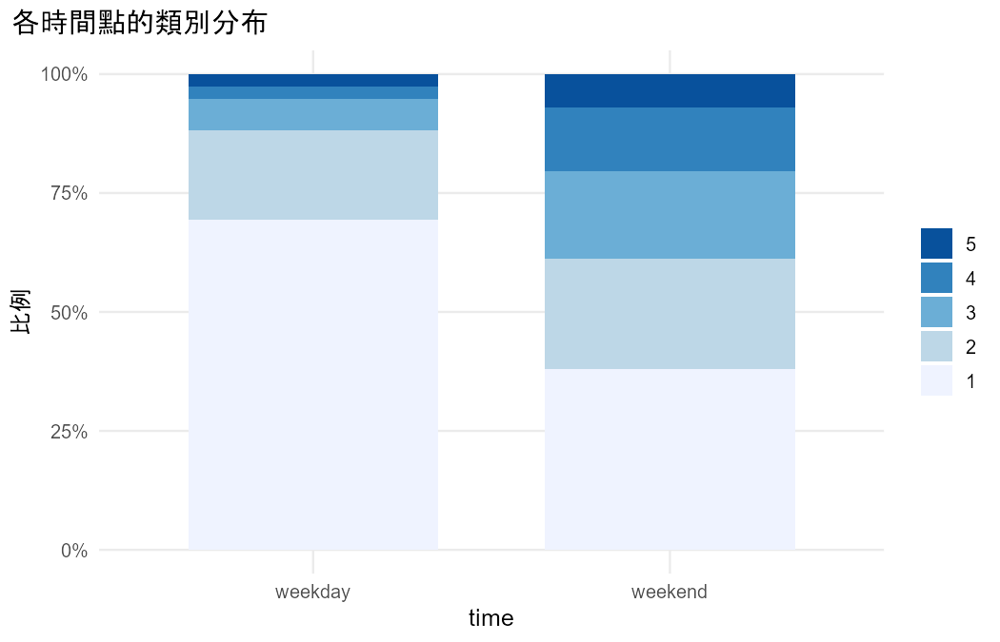

# 分析報告：平日與週末喝酒程度，男女有差嗎？

- 資料檔：`student_por.csv`
- 方法：Cumulative logit marginal model fitted by GEE（Agresti §9.3）
- 資料結構：repeated
- 效果的意義：整體平均（population-averaged）

## 描述統計

| time | n | prop_1 | prop_2 | prop_3 | prop_4 | prop_5 |
|---|---|---|---|---|---|---|
| weekday | 649 | 0.6949 | 0.1864 | 0.0663 | 0.0262 | 0.0262 |
| weekend | 649 | 0.3806 | 0.2311 | 0.1849 | 0.1341 | 0.0693 |

## 結果

- 資料沒有 id 欄，依列號產生 id（1–649），每一列視為一個叢集。
- 把 Dalc、Walc 轉成長格式：alc 欄為測量值，day 欄為時間（weekday = Dalc、weekend = Walc），共 1298 列。
- 共 649 個叢集、1298 筆觀察值；每個叢集的筆數：2 筆 649 個。
- 叢集間變數（同一個叢集內不變）：sex；叢集內變數（同一個叢集內會變）：day。
- 累積 logit 邊際模型（GEE），類別由低到高：1 < 2 < 3 < 4 < 5；局部勝算比結構 = independence。
- dayweekend：整體來說，落在較高類別的勝算比 = 4.446（95% 信賴區間 3.789 到 5.217），P < 0.001（每個切點相同）。
- sexM：整體來說，落在較高類別的勝算比 = 3.233（95% 信賴區間 2.454 到 4.260），P < 0.001（每個切點相同）。
- Wald (robust SE): day = 334.79（df = 1），P < 0.001。
- Wald (robust SE): sex = 69.59（df = 1），P < 0.001。

## 檢定

| test | statistic | df | p_value | book_ref |
|---|---|---|---|---|
| Wald (robust SE): day | 334.7909 | 1 | 8.697e-75 | §9.3 |
| Wald (robust SE): sex | 69.5908 | 1 | 7.298e-17 | §9.3 |

## 估計值

| term | estimate | se | z | p_value | odds_ratio_higher | or_lower | or_upper | or_reverse | or_reverse_lower | or_reverse_upper |
|---|---|---|---|---|---|---|---|---|---|---|
| dayweekend | -1.4920 | 0.0815 | -18.2973 | 8.697e-75 | 4.4461 | 3.7894 | 5.2166 | 0.2249 | 0.1917 | 0.2639 |
| sexM | -1.1735 | 0.1407 | -8.3421 | 7.298e-17 | 3.2332 | 2.4541 | 4.2595 | 0.3093 | 0.2348 | 0.4075 |

> GEE 的 robust SE 是大樣本方法，叢集少時傾向低估（§9.2.4）；本資料有 649 個叢集，課本沒有給門檻，請自行判斷是否足夠。

## 圖

> 比例勝算：模型假設每個切點的效果相同（§6.3.2、§9.3.1），第一版不做正式檢定。
