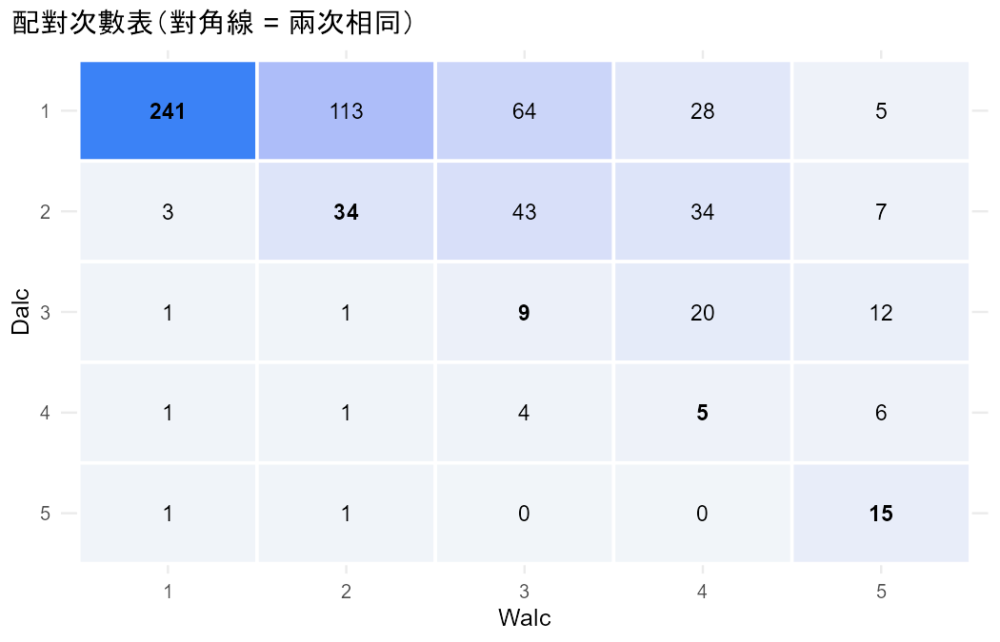
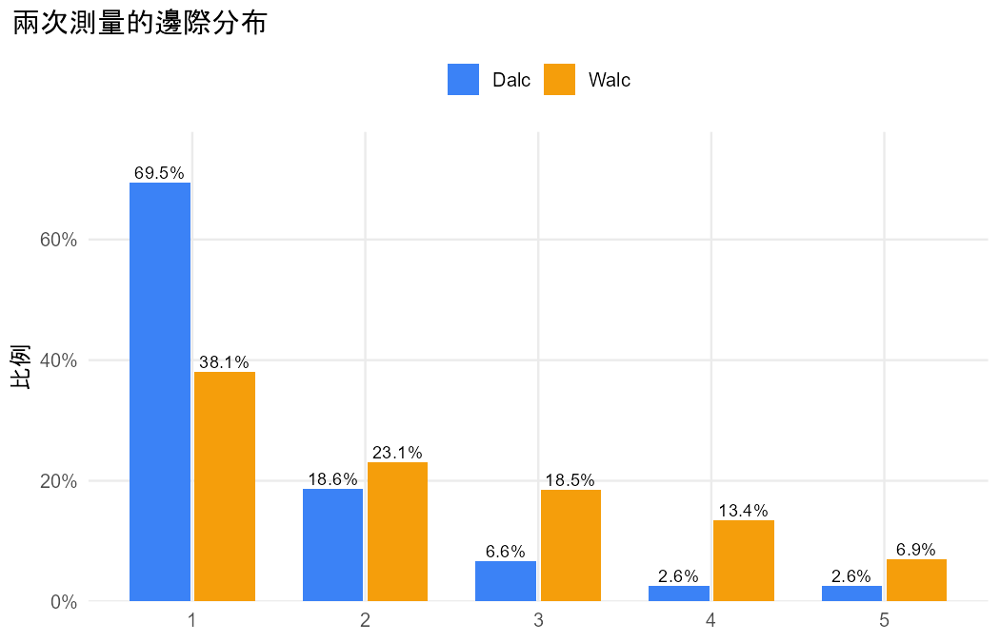

# 分析報告：學生平日和週末的喝酒程度一樣嗎？

- 資料檔：`student_por.csv`
- 方法：Cumulative logit marginal model for ordinal matched pairs（Agresti §8.4）
- 資料結構：paired
- 選擇理由：同一位學生的兩個有序回答（1–5），比較兩次是否整體偏高或偏低（§8.4）

## 配對次數表

列 = 第一次、欄 = 第二次。

|   | 1 | 2 | 3 | 4 | 5 |
|---|---|---|---|---|---|
| 1 | 241 | 113 | 64 | 28 | 5 |
| 2 | 3 | 34 | 43 | 34 | 7 |
| 3 | 1 | 1 | 9 | 20 | 12 |
| 4 | 1 | 1 | 4 | 5 | 6 |
| 5 | 1 | 1 | 0 | 0 | 15 |

## 描述統計

| category | Dalc_count | Dalc_prop | Walc_count | Walc_prop |
|---|---|---|---|---|
| 1 | 451 | 0.6949 | 247 | 0.3806 |
| 2 | 121 | 0.1864 | 150 | 0.2311 |
| 3 | 43 | 0.0663 | 120 | 0.1849 |
| 4 | 17 | 0.0262 | 87 | 0.1341 |
| 5 | 17 | 0.0262 | 45 | 0.0693 |

## 結果

- 共 649 人，每人兩次測量（Dalc、Walc），類別：1、2、3、4、5。
- 累積 logit 邊際模型（GEE）：β̂ = 1.371（robust SE 0.076），Wald z = 17.95，P < 0.001。
- Dalc 落在較高類別的勝算是 Walc 的 0.254 倍（95% 信賴區間 0.219 到 0.295）；反過來，Walc 落在較高類別的勝算是 Dalc 的 3.939 倍（3.391 到 4.575）。對每個切點都相同（比例勝算）。
- 方向：Dalc 傾向落在較低的類別（較接近「1」）。
- 逐人比較：Walc 比 Dalc 高的有 332 人（51.2%），較低的 13 人（2.0%），相同的 304 人（46.8%）。
- 對照：有序準對稱模型 β̂ = 2.192，和對稱模型比較 LR = 338.71（df = 1），P < 0.001；平均分數 Dalc = 1.50、Walc = 2.28（分數 1, 2, 3, 4, 5）。

## 檢定

| test | statistic | df | p_value | book_ref |
|---|---|---|---|---|
| Cumulative logit marginal model (GEE), Wald z^2 | 322.0378 | 1 | 5.212e-72 | §8.4.2 |
| Ordinal quasi-symmetry vs symmetry LR | 338.7055 | 1 | 1.221e-75 | §8.4.3 |

## 估計值

| measure | estimate | se | lower | upper | book_ref |
|---|---|---|---|---|---|
| beta: cumulative logit, first vs second (logit P(Y <= j)) | 1.3708 | 0.0764 | 1.2211 | 1.5206 | §8.4.1 |
| Odds ratio: Dalc in a higher category vs Walc | 0.2539 | — | 0.2186 | 0.2949 | §8.4.1 |
| Odds ratio: Walc in a higher category vs Dalc | 3.9387 | — | 3.3910 | 4.5748 | §8.4.1 |
| Ordinal quasi-symmetry beta | 2.1923 | 0.2081 | — | — | §8.4.3 |
| Mean score Dalc | 1.5023 | — | — | — | §8.4.3 |
| Mean score Walc | 2.2804 | — | — | — | §8.4.3 |

## 圖

> 比例勝算：模型假設每個切點的效果相同（§8.4.1）。平均分數取決於分數設定，只用來幫助描述方向。
