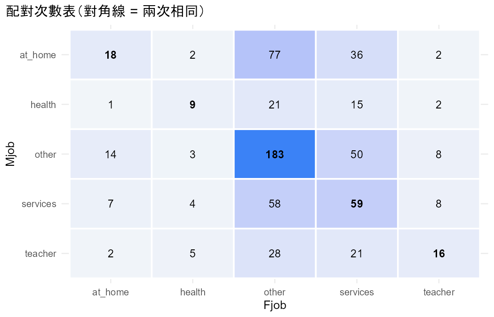
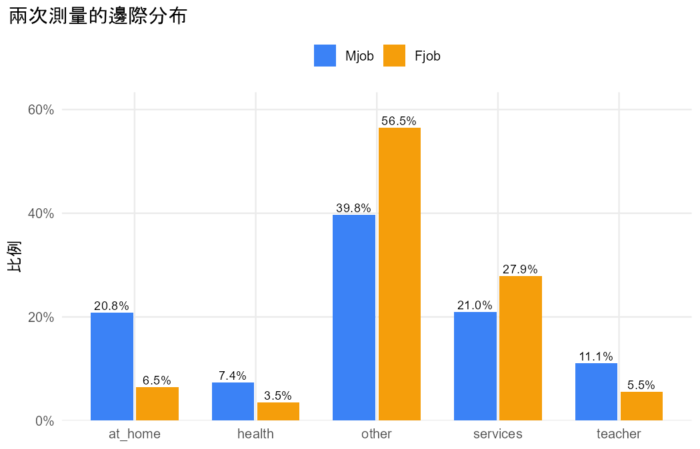

# 分析報告：媽媽和爸爸的職業分布不同嗎？

- 資料檔：`student_por.csv`
- 方法：Marginal homogeneity for nominal matched pairs（Agresti §8.3）
- 資料結構：paired

## 配對次數表

列 = 第一次、欄 = 第二次。

|   | at_home | health | other | services | teacher |
|---|---|---|---|---|---|
| at_home | 18 | 2 | 77 | 36 | 2 |
| health | 1 | 9 | 21 | 15 | 2 |
| other | 14 | 3 | 183 | 50 | 8 |
| services | 7 | 4 | 58 | 59 | 8 |
| teacher | 2 | 5 | 28 | 21 | 16 |

## 描述統計

| category | Mjob_count | Mjob_prop | Fjob_count | Fjob_prop |
|---|---|---|---|---|
| at_home | 135 | 0.2080 | 42 | 0.0647 |
| health | 48 | 0.0740 | 23 | 0.0354 |
| other | 258 | 0.3975 | 367 | 0.5655 |
| services | 136 | 0.2096 | 181 | 0.2789 |
| teacher | 72 | 0.1109 | 36 | 0.0555 |

## 結果

- 共 649 人，每人兩次測量（Mjob、Fjob），類別：at_home、health、other、services、teacher。
- 邊際同質性檢定（對稱 vs 準對稱模型）：LR = 108.45（df = 4），P < 0.001。
- 對照：CMH 檢定 = 99.80（df = 4），P < 0.001。
- 各類別的比例（Mjob → Fjob）：at_home 0.208 → 0.065；health 0.074 → 0.035；other 0.398 → 0.565；services 0.210 → 0.279；teacher 0.111 → 0.055。
- 各類別的比例差（Mjob − Fjob，95% score 信賴區間）：at_home 0.143（0.110 到 0.178）；health 0.039（0.017 到 0.062）；other -0.168（-0.215 到 -0.121）；services -0.069（-0.112 到 -0.027）；teacher 0.055（0.030 到 0.083）。
- 改變方向明顯不對稱的類別配對（|標準化殘差| > 2）：at_home → other vs other → at_home（6.60）；at_home → services vs services → at_home（4.42）；health → other vs other → health（3.67）；health → services vs services → health（2.52）；other → teacher vs teacher → other（-3.33）；services → teacher vs teacher → services（-2.41）。

## 檢定

| test | statistic | df | p_value | book_ref |
|---|---|---|---|---|
| Marginal homogeneity: symmetry vs quasi-symmetry LR | 108.4544 | 4 | 1.554e-22 | §8.3.4 |
| Symmetry model deviance (fit) | 111.4578 | 10 | 2.711e-19 | §8.3.4 |
| Quasi-symmetry model deviance (fit) | 3.0034 | 6 | 0.8084 | §8.3.4 |
| CMH (score test of marginal homogeneity) | 99.7954 | 4 | 1.087e-20 | §8.3.3 |

## 估計值

| category | prop_1 | prop_2 | difference | lower | upper | n12 | n21 | z | p_value |
|---|---|---|---|---|---|---|---|---|---|
| at_home | 0.2080 | 0.0647 | 0.1433 | 0.1098 | 0.1784 | 117 | 24 | 7.8320 | 4.801e-15 |
| health | 0.0740 | 0.0354 | 0.0385 | 0.0172 | 0.0619 | 39 | 14 | 3.4340 | 5.947e-04 |
| other | 0.3975 | 0.5655 | -0.1680 | -0.2147 | -0.1208 | 75 | 184 | -6.7729 | 1.262e-11 |
| services | 0.2096 | 0.2789 | -0.0693 | -0.1118 | -0.0270 | 77 | 122 | -3.1900 | 0.0014 |
| teacher | 0.1109 | 0.0555 | 0.0555 | 0.0299 | 0.0828 | 56 | 20 | 4.1295 | 3.636e-05 |

## 圖

> 逐類別的追蹤檢定（estimates）沒有做多重比較校正，只用來描述哪些類別改變；整體結論以邊際同質性檢定為準（§8.3.2）。
