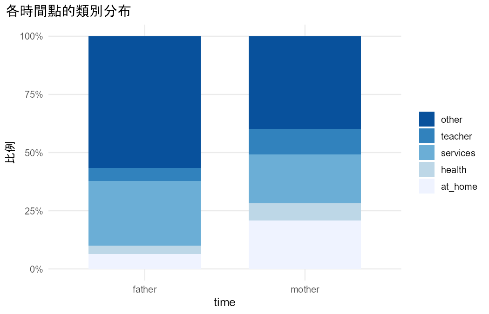

# 分析報告：Baseline-category logit marginal model fitted by GEE

- 資料檔：`student_por.csv`
- 方法：Baseline-category logit marginal model fitted by GEE（Agresti §9.3）
- 效果的意義：整體平均（population-averaged）

## 描述統計

| time | n | prop_at_home | prop_health | prop_services | prop_teacher | prop_other |
|---|---|---|---|---|---|---|
| father | 649 | 0.0647 | 0.0354 | 0.2789 | 0.0555 | 0.5655 |
| mother | 649 | 0.2080 | 0.0740 | 0.2096 | 0.1109 | 0.3975 |

## 結果

- 資料沒有 id 欄，依列號產生 id（1–649），每一列視為一個叢集。
- 把 Mjob、Fjob 轉成長格式：job 欄為測量值，parent 欄為時間（mother = Mjob、father = Fjob），共 1298 列。
- 共 649 個叢集、1298 筆觀察值；每個叢集的筆數：2 筆 649 個。
- 叢集間變數（同一個叢集內不變）：school；叢集內變數（同一個叢集內會變）：parent。
- baseline-category logit 邊際模型（GEE），基準類別 =「other」；局部勝算比結構 = independence。
- parentmother（at_home vs other）：整體來說，勝算比 = 4.659（95% 信賴區間 3.238 到 6.703），P < 0.001。
- schoolMS（at_home vs other）：整體來說，勝算比 = 2.402（95% 信賴區間 1.663 到 3.470），P < 0.001。
- parentmother（health vs other）：整體來說，勝算比 = 2.939（95% 信賴區間 1.861 到 4.642），P < 0.001。
- schoolMS（health vs other）：整體來說，勝算比 = 0.572（95% 信賴區間 0.298 到 1.095），P = 0.092。
- parentmother（services vs other）：整體來說，勝算比 = 1.068（95% 信賴區間 0.838 到 1.359），P = 0.596。
- schoolMS（services vs other）：整體來說，勝算比 = 0.939（95% 信賴區間 0.689 到 1.280），P = 0.690。
- parentmother（teacher vs other）：整體來說，勝算比 = 2.809（95% 信賴區間 1.934 到 4.081），P < 0.001。
- schoolMS（teacher vs other）：整體來說，勝算比 = 0.474（95% 信賴區間 0.268 到 0.840），P = 0.010。
- Wald (robust SE): parent = 102.33（df = 4），P < 0.001。
- Wald (robust SE): school = 38.28（df = 4），P < 0.001。

## 檢定

| test | statistic | df | p_value | book_ref |
|---|---|---|---|---|
| Wald (robust SE): parent | 102.3325 | 4 | 3.135e-21 | §9.3 |
| Wald (robust SE): school | 38.2762 | 4 | 9.828e-08 | §9.3 |

## 估計值

| term | category | estimate | se | z | p_value | odds_ratio | or_lower | or_upper | or_reverse | or_reverse_lower | or_reverse_upper |
|---|---|---|---|---|---|---|---|---|---|---|---|
| parentmother | at_home | 1.5387 | 0.1856 | 8.2903 | 1.130e-16 | 4.6587 | 3.2380 | 6.7027 | 0.2147 | 0.1492 | 0.3088 |
| schoolMS | at_home | 0.8764 | 0.1876 | 4.6714 | 2.991e-06 | 2.4023 | 1.6631 | 3.4699 | 0.4163 | 0.2882 | 0.6013 |
| parentmother | health | 1.0782 | 0.2332 | 4.6240 | 3.764e-06 | 2.9394 | 1.8611 | 4.6424 | 0.3402 | 0.2154 | 0.5373 |
| schoolMS | health | -0.5592 | 0.3317 | -1.6857 | 0.0918 | 0.5717 | 0.2984 | 1.0952 | 1.7492 | 0.9131 | 3.3511 |
| parentmother | services | 0.0653 | 0.1233 | 0.5297 | 0.5964 | 1.0675 | 0.8383 | 1.3595 | 0.9368 | 0.7356 | 1.1929 |
| schoolMS | services | -0.0629 | 0.1579 | -0.3982 | 0.6905 | 0.9390 | 0.6891 | 1.2797 | 1.0649 | 0.7814 | 1.4513 |
| parentmother | teacher | 1.0329 | 0.1905 | 5.4214 | 5.915e-08 | 2.8092 | 1.9338 | 4.0809 | 0.3560 | 0.2450 | 0.5171 |
| schoolMS | teacher | -0.7467 | 0.2918 | -2.5590 | 0.0105 | 0.4739 | 0.2675 | 0.8396 | 2.1100 | 1.1910 | 3.7382 |

> GEE 的 robust SE 是大樣本方法，叢集少時傾向低估（§9.2.4）；本資料有 649 個叢集，課本沒有給門檻，請自行判斷是否足夠。

## 圖

> 每個勝算比都是「該類 vs 基準類別」；換基準類別不影響配適（§6.1）。
