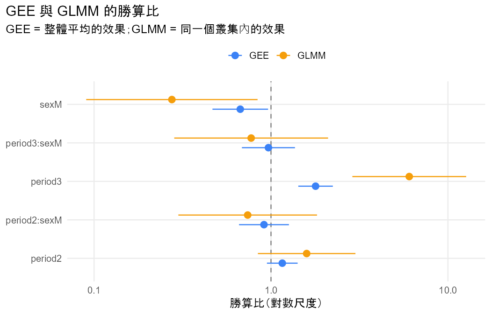

# 分析報告：interaction check

- 資料檔：`student_por.csv`
- 方法：GEE (population-averaged) vs GLMM (subject-specific)（Agresti §10.1.4, §10.2.5）

## 描述統計

| time | n | successes | proportion |
|---|---|---|---|
| 1 | 649 | 492 | 0.7581 |
| 2 | 649 | 504 | 0.7766 |
| 3 | 649 | 549 | 0.8459 |

## 結果

- 資料沒有 id 欄，依列號產生 id（1–649），每一列視為一個叢集。
- 把 G1、G2、G3 轉成長格式：G 欄為測量值，period 欄為時間（1 = G1、2 = G2、3 = G3），共 1947 列。
- 新變數 passed 由 G 轉換：< 10 → fail；≥ 10 → pass。
- 提醒：把連續的 G 切成類別會損失資訊，結論可能隨切點改變。
- 同一份資料（649 個叢集、1947 筆）分別配適 GEE（整體平均）與 GLMM（同一個叢集）。
- period2：GEE 估計 0.147（SE 0.102）、GLMM 估計 0.464（SE 0.324），GLMM / GEE = 3.16。
- period3：GEE 估計 0.580（SE 0.115）、GLMM 估計 1.799（SE 0.378），GLMM / GEE = 3.10。
- sexM：GEE 估計 -0.400（SE 0.185）、GLMM 估計 -1.290（SE 0.569），GLMM / GEE = 3.23。
- period2:sexM：GEE 估計 -0.091（SE 0.166）、GLMM 估計 -0.303（SE 0.460），GLMM / GEE = 3.33。
- period3:sexM：GEE 估計 -0.033（SE 0.176）、GLMM 估計 -0.258（SE 0.511），GLMM / GEE = 7.77。
- GLMM 的隨機效果標準差 σ̂ = 4.857；GEE 的 working correlation 估計 = 0.651。
- 兩者回答不同的問題：GEE 是母體中隨機抽的人的平均效果，GLMM 是固定同一個叢集時的效果；邏輯連結下，σ 越大，整體平均的效果越接近 0（§10.1.4）。

## 檢定

| test | statistic | df | p_value | book_ref |
|---|---|---|---|---|
| Wald (robust SE): period (with period:sex) | 48.6217 | 4 | 7.002e-10 | §9.2.4 |
| Wald (robust SE): sex (with period:sex) | 7.2507 | 3 | 0.0643 | §9.2.4 |
| Wald (robust SE): period:sex | 0.3182 | 2 | 0.8529 | §9.2.4 |
| Likelihood-ratio: period (with period:sex) | 50.0440 | 4 | 3.535e-10 | §10.1.6 |
| Likelihood-ratio: sex (with period:sex) | 8.9236 | 3 | 0.0303 | §10.1.6 |
| Likelihood-ratio: period:sex | 0.4886 | 2 | 0.7832 | §10.1.6 |
| Random effect sigma = 0 (LR, half chi-squared) | 527.1124 | 1 | 6.000e-117 | §10.1.6 |

## 估計值

| term | gee_estimate | gee_se | glmm_estimate | glmm_se | ratio | gee_or | glmm_or | gee_or_reverse | glmm_or_reverse |
|---|---|---|---|---|---|---|---|---|---|
| (Intercept) | 1.3160 | 0.1251 | 4.1585 | 0.5035 | 3.1600 | 3.7284 | 63.9731 | 0.2682 | 0.0156 |
| period2 | 0.1471 | 0.1019 | 0.4643 | 0.3238 | 3.1550 | 1.1585 | 1.5908 | 0.8632 | 0.6286 |
| period3 | 0.5801 | 0.1146 | 1.7992 | 0.3779 | 3.1013 | 1.7863 | 6.0448 | 0.5598 | 0.1654 |
| sexM | -0.3997 | 0.1846 | -1.2895 | 0.5689 | 3.2263 | 0.6705 | 0.2754 | 1.4914 | 3.6310 |
| period2:sexM | -0.0912 | 0.1656 | -0.3033 | 0.4603 | 3.3254 | 0.9128 | 0.7384 | 1.0955 | 1.3543 |
| period3:sexM | -0.0332 | 0.1762 | -0.2579 | 0.5106 | 7.7736 | 0.9674 | 0.7727 | 1.0337 | 1.2942 |

## 注意事項

- **QUADRATURE_UNSTABLE**：用 50 點和 100 點配適的估計值差異超過 0.0005（σ̂：4.842 vs 4.857），數值積分可能還沒穩定；以下報告 100 點的結果。（Agresti §10.1.5）
- **ALL_SAME_RESPONSE**：有 81.8% 的叢集所有回答都相同，σ̂ = 4.857：叢集之間差異越大，GLMM（同一個叢集）的效果就比 GEE（整體平均）大越多，SE 也一樣變大。這不是錯誤。（Agresti §10.1.4、§10.2.3）

## 圖

> 兩個模型的數字不同不代表其中一個算錯；結論通常相同（§10.2.3）。
