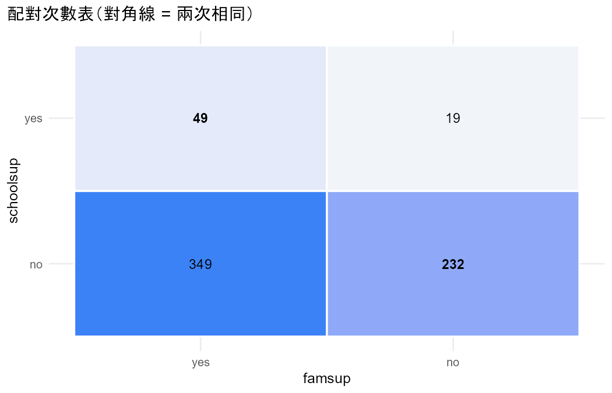
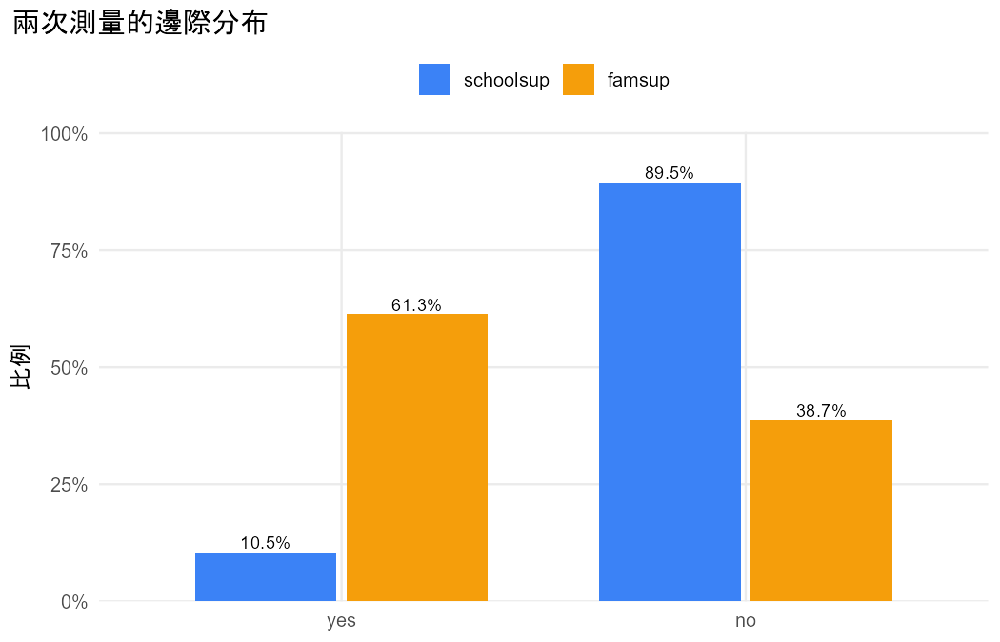

# 分析報告：smoke test: schoolsup vs famsup

- 資料檔：`student_por.csv`
- 方法：McNemar test for binary matched pairs（Agresti §8.1）
- 資料結構：paired

## 配對次數表

列 = 第一次、欄 = 第二次。

|   | yes | no |
|---|---|---|
| yes | 49 | 19 |
| no | 349 | 232 |

## 描述統計

| category | schoolsup_count | schoolsup_prop | famsup_count | famsup_prop |
|---|---|---|---|---|
| yes | 68 | 0.1048 | 398 | 0.6133 |
| no | 581 | 0.8952 | 251 | 0.3867 |

## 結果

- 共 649 人，每人兩次測量（schoolsup、famsup），類別：no、yes。
- schoolsup 選「yes」的比例 0.105，famsup 為 0.613，差 -0.508（95% score 信賴區間 -0.550 到 -0.465）。
- 回答改變的人：schoolsup 是「yes」但 famsup 不是的有 n12 = 19 人，反過來的有 n21 = 349 人；兩次回答相同的 281 人不影響檢定。
- 主要檢定：McNemar X2，P < 0.001。
- McNemar X² = 295.92（df = 1），P < 0.001；精確二項檢定 P < 0.001。
- 邊際勝算比（整體平均）：schoolsup 對 famsup = 0.074，famsup 對 schoolsup = 13.548。
- 條件勝算比（同一個人）：schoolsup 對 famsup = n12/n21 = 0.054，famsup 對 schoolsup = n21/n12 = 18.368。

## 檢定

| test | statistic | df | p_value | book_ref |
|---|---|---|---|---|
| McNemar X2 | 295.9239 | 1 | 2.546e-66 | §8.1.1 |
| Exact binomial (n12 ~ Bin(n*, 0.5)) | 19.0000 | — | 1.016e-79 | §8.1.1 |

## 估計值

| measure | estimate | lower | upper | book_ref |
|---|---|---|---|---|
| P(schoolsup = yes) | 0.1048 | — | — | §8.1 |
| P(famsup = yes) | 0.6133 | — | — | §8.1 |
| Difference of proportions (schoolsup - famsup) | -0.5085 | -0.5503 | -0.4648 | §8.1.2 |
| Difference of proportions (famsup - schoolsup) | 0.5085 | 0.4648 | 0.5503 | §8.1.2 |
| Marginal odds ratio schoolsup vs famsup (population-averaged) | 0.0738 | — | — | §8.2.2 |
| Marginal odds ratio famsup vs schoolsup (population-averaged) | 13.5480 | — | — | §8.2.2 |
| Conditional odds ratio n12/n21: schoolsup vs famsup (subject-specific) | 0.0544 | — | — | §8.2.4 |
| Conditional odds ratio n21/n12: famsup vs schoolsup (subject-specific) | 18.3684 | — | — | §8.2.4 |

## 圖

> McNemar 只用到回答改變的人；條件勝算比是個體層次，邊際勝算比是整體層次，兩者不可混稱（§8.2.4）。
