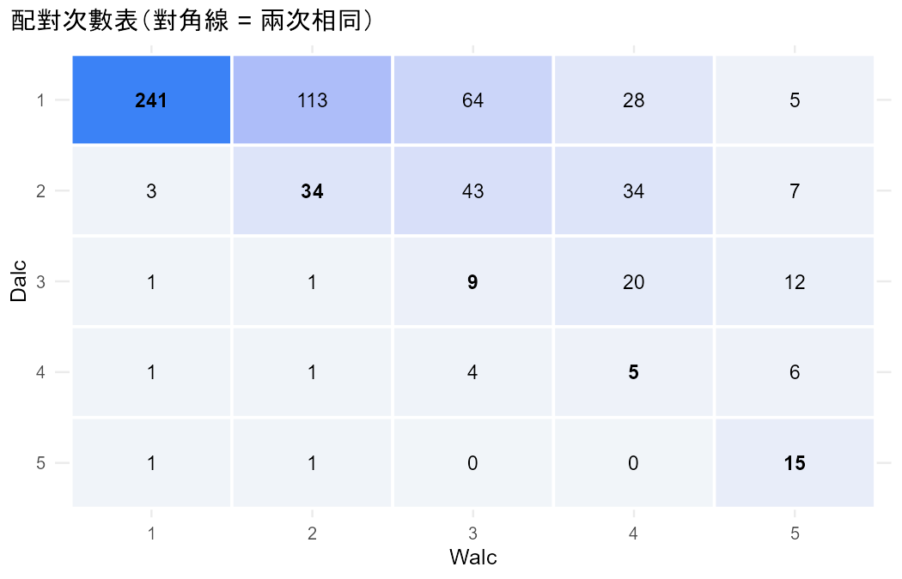
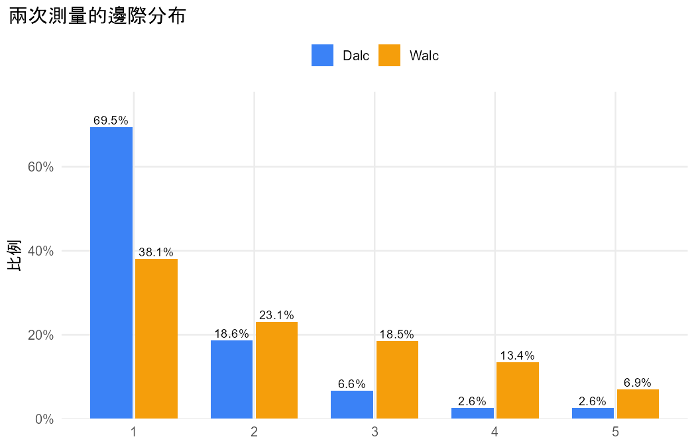

# 初步檢視：student_por.csv

問題：學生平日和週末的喝酒程度一樣嗎？

## 重點數字

- 共 649 人，每人兩次測量（Dalc、Walc），類別：1、2、3、4、5。
- 兩次回答相同（對角線）的有 304 人（46.8%）。

## 表

### counts

|   | 1 | 2 | 3 | 4 | 5 |
|---|---|---|---|---|---|
| 1 | 241 | 113 | 64 | 28 | 5 |
| 2 | 3 | 34 | 43 | 34 | 7 |
| 3 | 1 | 1 | 9 | 20 | 12 |
| 4 | 1 | 1 | 4 | 5 | 6 |
| 5 | 1 | 1 | 0 | 0 | 15 |

### marginal

| category | Dalc_count | Dalc_prop | Walc_count | Walc_prop |
|---|---|---|---|---|
| 1 | 451 | 0.6949 | 247 | 0.3806 |
| 2 | 121 | 0.1864 | 150 | 0.2311 |
| 3 | 43 | 0.0663 | 120 | 0.1849 |
| 4 | 17 | 0.0262 | 87 | 0.1341 |
| 5 | 17 | 0.0262 | 45 | 0.0693 |

## 圖

