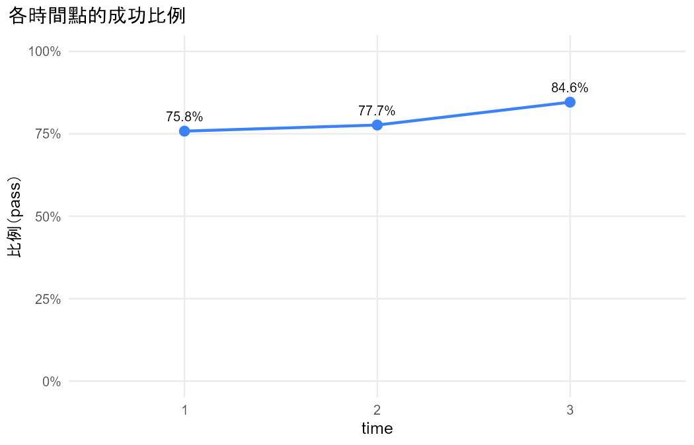
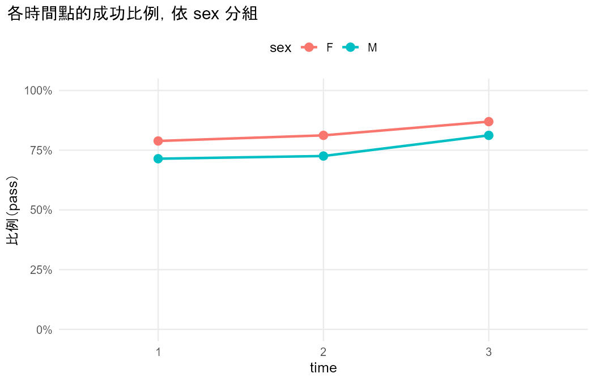

# 初步檢視：student_por.csv

問題：三次考試的及格率有變化嗎？和性別有關嗎？

## 重點數字

- 資料沒有 id 欄，依列號產生 id（1–649），每一列視為一個叢集。
- 把 G1、G2、G3 轉成長格式：G 欄為測量值，period 欄為時間（1 = G1、2 = G2、3 = G3），共 1947 列。
- 新變數 passed 由 G 轉換：< 10 → fail；≥ 10 → pass。
- 提醒：把連續的 G 切成類別會損失資訊，結論可能隨切點改變。
- 共 649 個叢集、1947 筆觀察值；每個叢集的筆數：3 筆 649 個。
- 結果變數 passed 的次數：fail 402、pass 1545。
- 有 81.8% 的叢集（≥ 2 筆）所有回答都相同。
- period 是叢集內（同一個叢集內會變）變數；sex 是叢集間（同一個叢集內不變）變數。

## 表

### proportions

| time | n | successes | proportion |
|---|---|---|---|
| 1 | 649 | 492 | 0.7581 |
| 2 | 649 | 504 | 0.7766 |
| 3 | 649 | 549 | 0.8459 |

### proportions_by_group

| time | group | n | proportion |
|---|---|---|---|
| 1 | F | 383 | 0.7885 |
| 2 | F | 383 | 0.8120 |
| 3 | F | 383 | 0.8695 |
| 1 | M | 266 | 0.7143 |
| 2 | M | 266 | 0.7256 |
| 3 | M | 266 | 0.8120 |

## 圖

