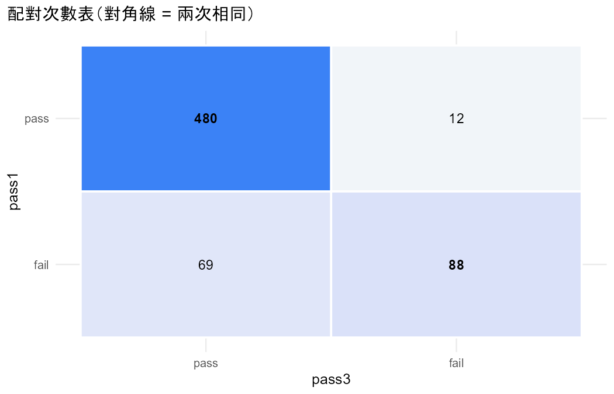
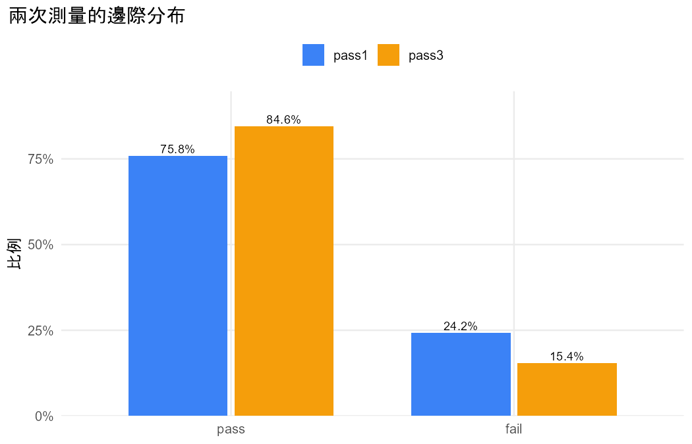

# 分析報告：第一次和第三次考試的及格率一樣嗎？

## 結論與解釋

1. **一句話結論**：有證據顯示，第三次考試的及格比例比第一次高。
2. **效果的大小與方向**：及格比例由 0.758 增加到 0.846，相差 0.088（95% score 信賴區間 0.063 到 0.116）。兩次結果不同的學生中，第一次不及格、第三次及格的有 69 人，反過來的有 12 人；McNemar X² = 40.11（df = 1），P < 0.001。整體來說，第三次及格的勝算是第一次的 1.752 倍（邊際勝算比）；對同一位學生，條件勝算比 n21/n12 = 5.750。
3. **注意事項**：G1、G3 以 10 分切成及格與否，會損失分數的資訊，結論可能隨切點改變。
4. **限制與下一步**：McNemar 只能比較兩次，也不能加入解釋變數（§8.1）。

- 資料檔：`student_por.csv`
- 方法：McNemar test for binary matched pairs（Agresti §8.1）
- 資料結構：paired
- 選擇理由：同一位學生兩次考試的及不及格，只比較兩次的分布（§8.1）

## 配對次數表

列 = 第一次、欄 = 第二次。

|   | pass | fail |
|---|---|---|
| pass | 480 | 12 |
| fail | 69 | 88 |

## 描述統計

| category | pass1_count | pass1_prop | pass3_count | pass3_prop |
|---|---|---|---|---|
| pass | 492 | 0.7581 | 549 | 0.8459 |
| fail | 157 | 0.2419 | 100 | 0.1541 |

## 結果

- 新變數 pass1 由 G1 轉換：< 10 → fail；≥ 10 → pass。
- 提醒：把連續的 G1 切成類別會損失資訊，結論可能隨切點改變。
- 新變數 pass3 由 G3 轉換：< 10 → fail；≥ 10 → pass。
- 提醒：把連續的 G3 切成類別會損失資訊，結論可能隨切點改變。
- 共 649 人，每人兩次測量（pass1、pass3），類別：fail、pass。
- pass1 選「pass」的比例 0.758，pass3 為 0.846，差 -0.088（95% score 信賴區間 -0.116 到 -0.063）。
- 回答改變的人：pass1 是「pass」但 pass3 不是的有 n12 = 12 人，反過來的有 n21 = 69 人；兩次回答相同的 568 人不影響檢定。
- 主要檢定：McNemar X2，P < 0.001。
- McNemar X² = 40.11（df = 1），P < 0.001；精確二項檢定 P < 0.001。
- 邊際勝算比（整體平均）：pass1 對 pass3 = 0.571，pass3 對 pass1 = 1.752。
- 條件勝算比（同一個人）：pass1 對 pass3 = n12/n21 = 0.174，pass3 對 pass1 = n21/n12 = 5.750。

## 檢定

| test | statistic | df | p_value | book_ref |
|---|---|---|---|---|
| McNemar X2 | 40.1111 | 1 | 2.399e-10 | §8.1.1 |
| Exact binomial (n12 ~ Bin(n*, 0.5)) | 12.0000 | — | 7.033e-11 | §8.1.1 |

## 估計值

| measure | estimate | lower | upper | book_ref |
|---|---|---|---|---|
| P(pass1 = pass) | 0.7581 | — | — | §8.1 |
| P(pass3 = pass) | 0.8459 | — | — | §8.1 |
| Difference of proportions (pass1 - pass3) | -0.0878 | -0.1158 | -0.0626 | §8.1.2 |
| Difference of proportions (pass3 - pass1) | 0.0878 | 0.0626 | 0.1158 | §8.1.2 |
| Marginal odds ratio pass1 vs pass3 (population-averaged) | 0.5708 | — | — | §8.2.2 |
| Marginal odds ratio pass3 vs pass1 (population-averaged) | 1.7519 | — | — | §8.2.2 |
| Conditional odds ratio n12/n21: pass1 vs pass3 (subject-specific) | 0.1739 | — | — | §8.2.4 |
| Conditional odds ratio n21/n12: pass3 vs pass1 (subject-specific) | 5.7500 | — | — | §8.2.4 |

## 圖

> McNemar 只用到回答改變的人；條件勝算比是個體層次，邊際勝算比是整體層次，兩者不可混稱（§8.2.4）。
