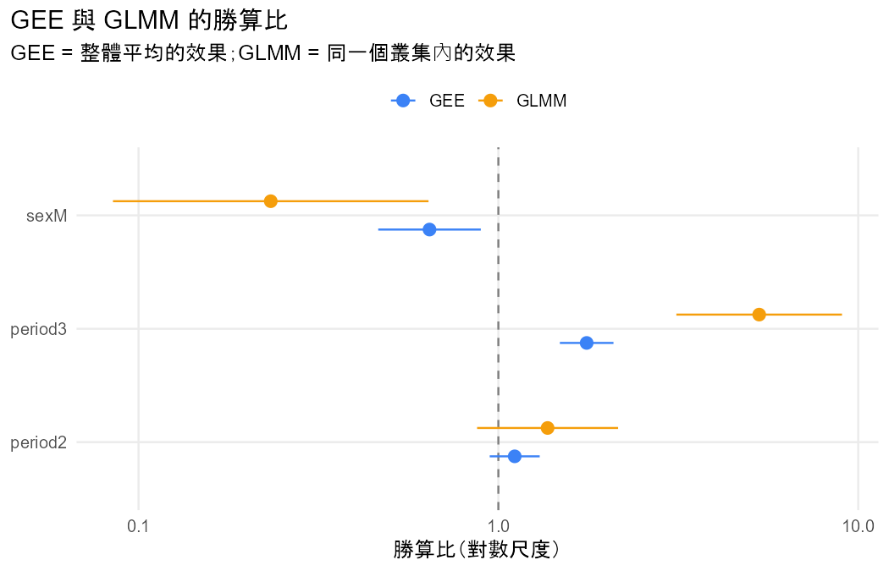

# 分析報告：整體平均和同一位學生的效果各是多少？

## 結論與解釋

1. **一句話結論**：GEE 與 GLMM 的方向一致：第 3 次考試及格的勝算較高，男生及格的勝算較低。
2. **效果的大小與方向**：
   - 整體來說（GEE），第 3 次及格的勝算是第 1 次的 1.759 倍；男生是女生的 0.644 倍（女生是男生的 1.554 倍）。性別的 robust Wald = 6.92（df = 1），P = 0.0085。
   - 對同一位學生（GLMM），第 3 次及格的勝算是第 1 次的 5.306 倍；男生是女生的 0.233 倍（女生是男生的 4.291 倍）。性別的 LR = 8.44（df = 1），P = 0.0037。
   - GLMM 的係數約是 GEE 的 3 倍（period3 為 2.95 倍），因為隨機效果標準差 σ̂ = 4.844 很大：學生之間的及格傾向差異很大。兩者回答不同的問題，不是其中一個算錯（§10.1.4）。
3. **注意事項**：
   - QUADRATURE_UNSTABLE：兩種點數的估計值差異超過 0.0005，已採用點數較多的結果。
   - ALL_SAME_RESPONSE：81.8% 的學生三次結果都相同，這是 GLMM 效果比 GEE 大很多的原因，不是錯誤。
4. **限制與下一步**：本模型拿掉了交互作用（上一步的證據不足）；只用隨機截距，沒有隨機斜率（§10.3）。

- 資料檔：`student_por.csv`
- 方法：GEE (population-averaged) vs GLMM (subject-specific)（Agresti §10.1.4, §10.2.5）
- 資料結構：repeated
- 選擇理由：使用者也想知道同一位學生的效果；交互作用的證據不足，使用者決定拿掉（§10.1.4）

## 描述統計

| time | n | successes | proportion |
|---|---|---|---|
| 1 | 649 | 492 | 0.7581 |
| 2 | 649 | 504 | 0.7766 |
| 3 | 649 | 549 | 0.8459 |

## 結果

- 資料沒有 id 欄，依列號產生 id（1–649），每一列視為一個叢集。
- 把 G1、G2、G3 轉成長格式：G 欄為測量值，period 欄為時間（1 = G1、2 = G2、3 = G3），共 1947 列。
- 新變數 passed 由 G 轉換：< 10 → fail；≥ 10 → pass。
- 提醒：把連續的 G 切成類別會損失資訊，結論可能隨切點改變。
- 同一份資料（649 個叢集、1947 筆）分別配適 GEE（整體平均）與 GLMM（同一個叢集）。
- period2：GEE 估計 0.105（SE 0.082）、GLMM 估計 0.315（SE 0.230），GLMM / GEE = 3.01。
- period3：GEE 估計 0.565（SE 0.088）、GLMM 估計 1.669（SE 0.270），GLMM / GEE = 2.95。
- sexM：GEE 估計 -0.441（SE 0.167）、GLMM 估計 -1.457（SE 0.515），GLMM / GEE = 3.31。
- GLMM 的隨機效果標準差 σ̂ = 4.844；GEE 的 working correlation 估計 = 0.651。
- 兩者回答不同的問題：GEE 是母體中隨機抽的人的平均效果，GLMM 是固定同一個叢集時的效果；邏輯連結下，σ 越大，整體平均的效果越接近 0（§10.1.4）。

## 檢定

| test | statistic | df | p_value | book_ref |
|---|---|---|---|---|
| Wald (robust SE): period | 47.8485 | 2 | 4.072e-11 | §9.2.4 |
| Wald (robust SE): sex | 6.9235 | 1 | 0.0085 | §9.2.4 |
| Likelihood-ratio: period | 49.5554 | 2 | 1.735e-11 | §10.1.6 |
| Likelihood-ratio: sex | 8.4350 | 1 | 0.0037 | §10.1.6 |
| Random effect sigma = 0 (LR, half chi-squared) | 526.7444 | 1 | 7.214e-117 | §10.1.6 |

## 估計值

| term | gee_estimate | gee_se | glmm_estimate | glmm_se | ratio | gee_or | glmm_or | gee_or_reverse | glmm_or_reverse |
|---|---|---|---|---|---|---|---|---|---|
| (Intercept) | 1.3348 | 0.1232 | 4.2308 | 0.4936 | 3.1695 | 3.7994 | 68.7689 | 0.2632 | 0.0145 |
| period2 | 0.1045 | 0.0816 | 0.3150 | 0.2302 | 3.0139 | 1.1102 | 1.3702 | 0.9008 | 0.7298 |
| period3 | 0.5650 | 0.0875 | 1.6689 | 0.2704 | 2.9540 | 1.7594 | 5.3064 | 0.5684 | 0.1885 |
| sexM | -0.4406 | 0.1675 | -1.4566 | 0.5151 | 3.3058 | 0.6436 | 0.2330 | 1.5537 | 4.2914 |

## 注意事項

- **QUADRATURE_UNSTABLE**：用 50 點和 100 點配適的估計值差異超過 0.0005（σ̂：4.829 vs 4.844），數值積分可能還沒穩定；以下報告 100 點的結果。（Agresti §10.1.5）
- **ALL_SAME_RESPONSE**：有 81.8% 的叢集所有回答都相同，σ̂ = 4.844：叢集之間差異越大，GLMM（同一個叢集）的效果就比 GEE（整體平均）大越多，SE 也一樣變大。這不是錯誤。（Agresti §10.1.4、§10.2.3）

## 圖

> 兩個模型的數字不同不代表其中一個算錯；結論通常相同（§10.2.3）。
