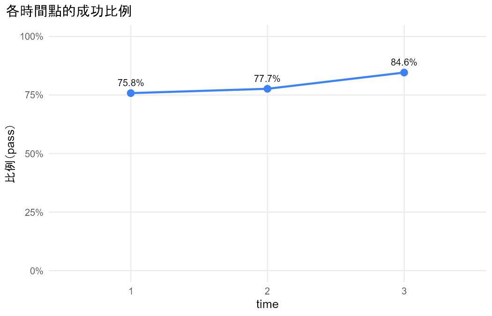
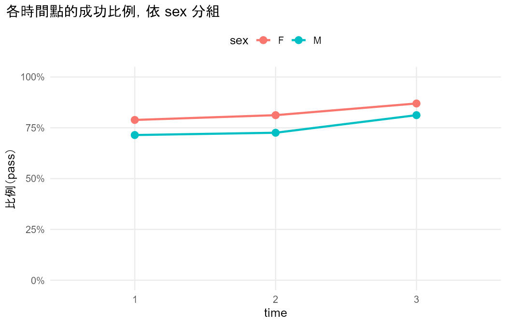
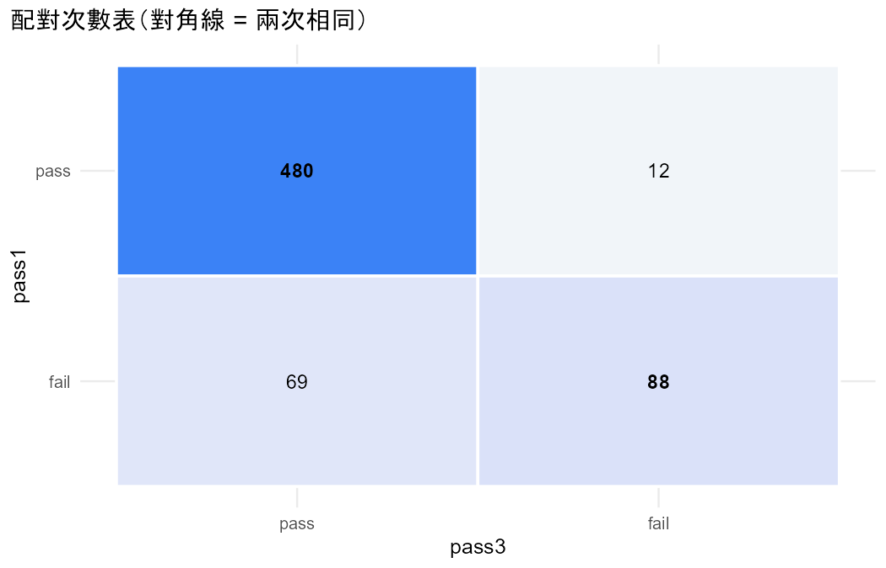
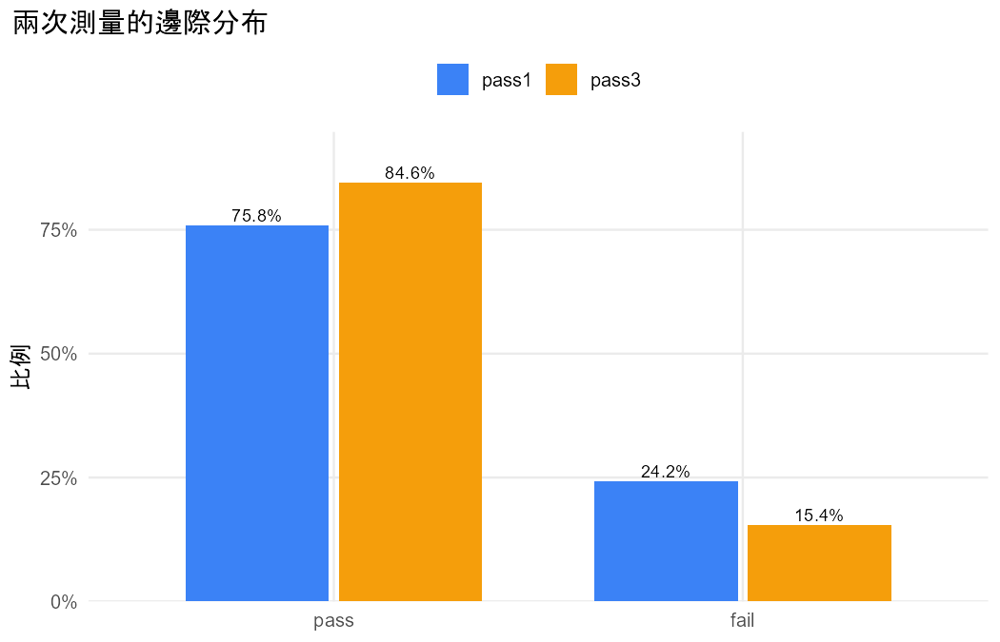
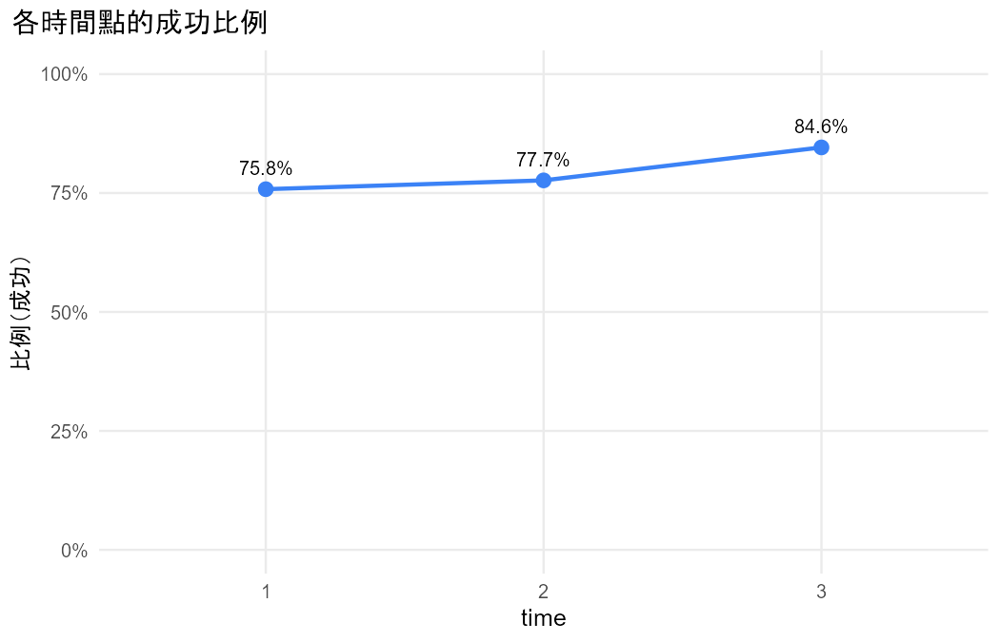
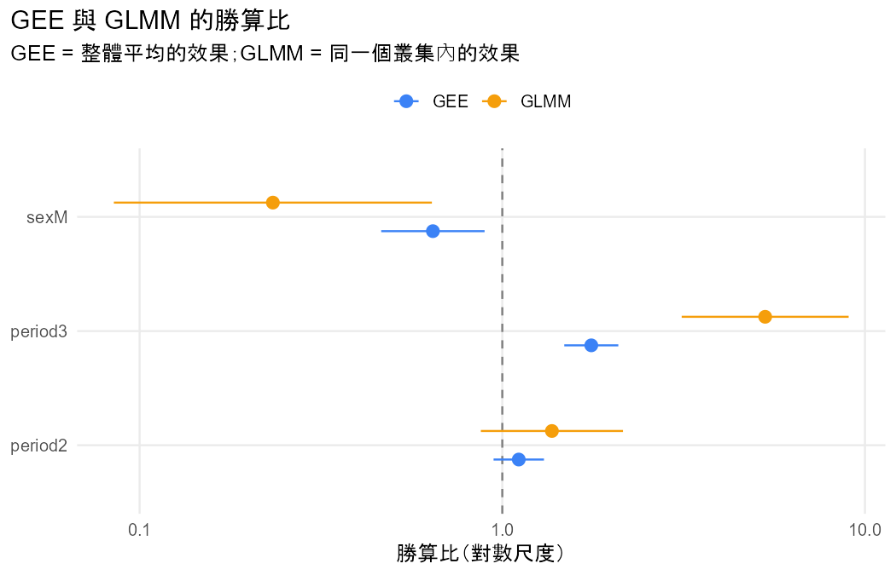

# 資料與研究問題

- 資料檔：`student_por.csv`
- 研究問題：學生三次考試的及格率有沒有改變？和性別有關嗎？（測試用：使用者的選擇由開發者模擬）
- 資料大小：共 649 列、34 欄
- 分析步驟：共 3 步

# 確認的設定

以下設定在分析開始前和使用者確認過。

- ① 不獨立：同一位學生的 G1、G2、G3，叢集單位是學生（每一列一位學生）
- ② 資料格式：寬格式，G1–G3 合併成長格式，時間 period = 1、2、3
- ③ 結果變數：G 以 10 分切成 fail／pass（使用者同意切分，並知道會損失資訊）
- ⑤ 解釋變數：sex（參考組 F），時間當類別
- ⑦ 成功類別：pass
- ⑧ GEE 的 working correlation：exchangeable

# 初步檢視


問題：三次考試的及格率有變化嗎？和性別有關嗎？

## 重點數字

- 資料沒有 id 欄，依列號產生 id（1–649），每一列視為一個叢集。
- 把 G1、G2、G3 轉成長格式：G 欄為測量值，period 欄為時間（1 = G1、2 = G2、3 = G3），共 1947 列。
- 新變數 passed 由 G 轉換：< 10 → fail；≥ 10 → pass。
- 提醒：把連續的 G 切成類別會損失資訊，結論可能隨切點改變。
- 共 649 個叢集、1947 筆觀察值；每個叢集的筆數：3 筆 649 個。
- 結果變數 passed 的次數：fail 402、pass 1545。
- 有 81.8% 的叢集（≥ 2 筆）所有回答都相同。
- period 是叢集內（同一個叢集內會變）變數；sex 是叢集間（同一個叢集內不變）變數。

## 表

### proportions

| time | n | successes | proportion |
|---|---|---|---|
| 1 | 649 | 492 | 0.7581 |
| 2 | 649 | 504 | 0.7766 |
| 3 | 649 | 549 | 0.8459 |

### proportions_by_group

| time | group | n | proportion |
|---|---|---|---|
| 1 | F | 383 | 0.7885 |
| 2 | F | 383 | 0.8120 |
| 3 | F | 383 | 0.8695 |
| 1 | M | 266 | 0.7143 |
| 2 | M | 266 | 0.7256 |
| 3 | M | 266 | 0.8120 |

## 圖




# 分析過程

## 第 1 步：第一次和第三次考試的及格率一樣嗎？

**方法**：McNemar 檢定（§8.1）

### 為什麼做這一步

使用者想先看頭尾兩次考試有沒有差別：同一位學生兩次的二元結果，用 McNemar 檢定（§8.1）。


### 結論與解釋

1. **一句話結論**：有證據顯示，第三次考試的及格比例比第一次高。
2. **效果的大小與方向**：及格比例由 0.758 增加到 0.846，相差 0.088（95% score 信賴區間 0.063 到 0.116）。兩次結果不同的學生中，第一次不及格、第三次及格的有 69 人，反過來的有 12 人；McNemar X² = 40.11（df = 1），P < 0.001。整體來說，第三次及格的勝算是第一次的 1.752 倍（邊際勝算比）；對同一位學生，條件勝算比 n21/n12 = 5.750。
3. **注意事項**：G1、G3 以 10 分切成及格與否，會損失分數的資訊，結論可能隨切點改變。
4. **限制與下一步**：McNemar 只能比較兩次，也不能加入解釋變數（§8.1）。


### 配對次數表

列 = 第一次、欄 = 第二次。

|   | pass | fail |
|---|---|---|
| pass | 480 | 12 |
| fail | 69 | 88 |

### 描述統計

| category | pass1_count | pass1_prop | pass3_count | pass3_prop |
|---|---|---|---|---|
| pass | 492 | 0.7581 | 549 | 0.8459 |
| fail | 157 | 0.2419 | 100 | 0.1541 |

### 結果

- 新變數 pass1 由 G1 轉換：< 10 → fail；≥ 10 → pass。
- 提醒：把連續的 G1 切成類別會損失資訊，結論可能隨切點改變。
- 新變數 pass3 由 G3 轉換：< 10 → fail；≥ 10 → pass。
- 提醒：把連續的 G3 切成類別會損失資訊，結論可能隨切點改變。
- 共 649 人，每人兩次測量（pass1、pass3），類別：fail、pass。
- pass1 選「pass」的比例 0.758，pass3 為 0.846，差 -0.088（95% score 信賴區間 -0.116 到 -0.063）。
- 回答改變的人：pass1 是「pass」但 pass3 不是的有 n12 = 12 人，反過來的有 n21 = 69 人；兩次回答相同的 568 人不影響檢定。
- 主要檢定：McNemar X2，P < 0.001。
- McNemar X² = 40.11（df = 1），P < 0.001；精確二項檢定 P < 0.001。
- 邊際勝算比（整體平均）：pass1 對 pass3 = 0.571，pass3 對 pass1 = 1.752。
- 條件勝算比（同一個人）：pass1 對 pass3 = n12/n21 = 0.174，pass3 對 pass1 = n21/n12 = 5.750。

### 檢定

| test | statistic | df | p_value | book_ref |
|---|---|---|---|---|
| McNemar X2 | 40.1111 | 1 | 2.399e-10 | §8.1.1 |
| Exact binomial (n12 ~ Bin(n*, 0.5)) | 12.0000 | — | 7.033e-11 | §8.1.1 |

### 估計值

| measure | estimate | lower | upper | book_ref |
|---|---|---|---|---|
| P(pass1 = pass) | 0.7581 | — | — | §8.1 |
| P(pass3 = pass) | 0.8459 | — | — | §8.1 |
| Difference of proportions (pass1 - pass3) | -0.0878 | -0.1158 | -0.0626 | §8.1.2 |
| Difference of proportions (pass3 - pass1) | 0.0878 | 0.0626 | 0.1158 | §8.1.2 |
| Marginal odds ratio pass1 vs pass3 (population-averaged) | 0.5708 | — | — | §8.2.2 |
| Marginal odds ratio pass3 vs pass1 (population-averaged) | 1.7519 | — | — | §8.2.2 |
| Conditional odds ratio n12/n21: pass1 vs pass3 (subject-specific) | 0.1739 | — | — | §8.2.4 |
| Conditional odds ratio n21/n12: pass3 vs pass1 (subject-specific) | 5.7500 | — | — | §8.2.4 |

### 圖




> McNemar 只用到回答改變的人；條件勝算比是個體層次，邊際勝算比是整體層次，兩者不可混稱（§8.2.4）。

### 下一步的建議

| # | 建議 | 方法 | 理由 |
|---|---|---|---|
| 1 | 三次一起看，並加入性別（含時間 × 性別交互作用）（推薦） | GEE 邊際 logistic 模型（§9.2） | McNemar 只能比兩次，也不能加解釋變數；使用者的問題包含性別（§9.2） |
| 2 | 改比第一次和第二次 | McNemar 檢定（§8.1） | 看及格率在哪一段改變（§8.1） |
| 3 | 結束，產生整份分析報告 |  | 頭尾兩次的問題已經回答 |

**使用者的選擇**：選 1

## 第 2 步：三次考試的及格率有變化嗎？變化和性別有關嗎？

**方法**：GEE 邊際 logistic 模型（§9.2）

### 為什麼做這一步

使用者選了上一步的建議 1：三次一起看，並加入性別與交互作用（§9.2）。


### 結論與解釋

1. **一句話結論**：有證據顯示，整體的及格比例隨考試次數改變；男女的變化是否不同，證據不足。
2. **效果的大小與方向**：整體來說，第 3 次及格的勝算是第 1 次的 1.786 倍（95% 信賴區間 1.427 到 2.236，P < 0.001）；第 2 次是第 1 次的 1.159 倍（95% 信賴區間 0.949 到 1.415，P = 0.149），證據不足。時間 × 性別交互作用的 robust Wald = 0.32（df = 2），P = 0.853，兩個交互作用的信賴區間都包含 1。模型含交互作用時，sexM 的勝算比 0.671 只代表第 1 次考試的性別差異。
3. **注意事項**：本資料有 649 個叢集，robust SE 是大樣本方法（§9.2.4）；估計的 working correlation 為 0.651，同一位學生三次的結果高度相關。
4. **限制與下一步**：GEE 的效果是整體平均，不代表同一位學生的變化（§10.1.4）。


- 效果的意義：整體平均（population-averaged）

### 描述統計

| time | n | successes | proportion |
|---|---|---|---|
| 1 | 649 | 492 | 0.7581 |
| 2 | 649 | 504 | 0.7766 |
| 3 | 649 | 549 | 0.8459 |

### 結果

- 資料沒有 id 欄，依列號產生 id（1–649），每一列視為一個叢集。
- 把 G1、G2、G3 轉成長格式：G 欄為測量值，period 欄為時間（1 = G1、2 = G2、3 = G3），共 1947 列。
- 新變數 passed 由 G 轉換：< 10 → fail；≥ 10 → pass。
- 提醒：把連續的 G 切成類別會損失資訊，結論可能隨切點改變。
- 共 649 個叢集、1947 筆觀察值；每個叢集的筆數：3 筆 649 個。
- 叢集間變數（同一個叢集內不變）：sex；叢集內變數（同一個叢集內會變）：period。
- 邊際 logistic 模型（GEE），成功 =「pass」，working correlation = exchangeable（估計相關 0.651）。
- period2：整體來說，勝算比 = 1.159（95% 信賴區間 0.949 到 1.415），P = 0.149。
- period3：整體來說，勝算比 = 1.786（95% 信賴區間 1.427 到 2.236），P < 0.001。
- sexM：整體來說，勝算比 = 0.671（95% 信賴區間 0.467 到 0.963），P = 0.030。
- period2:sexM：整體來說，勝算比 = 0.913（95% 信賴區間 0.660 到 1.263），P = 0.582。
- period3:sexM：整體來說，勝算比 = 0.967（95% 信賴區間 0.685 到 1.366），P = 0.851。
- Wald (robust SE): period (with period:sex) = 48.62（df = 4），P < 0.001。
- Wald (robust SE): sex (with period:sex) = 7.25（df = 3），P = 0.064。
- Wald (robust SE): period:sex = 0.32（df = 2），P = 0.853。

### 檢定

| test | statistic | df | p_value | book_ref |
|---|---|---|---|---|
| Wald (robust SE): period (with period:sex) | 48.6217 | 4 | 7.002e-10 | §9.2.4 |
| Wald (robust SE): sex (with period:sex) | 7.2507 | 3 | 0.0643 | §9.2.4 |
| Wald (robust SE): period:sex | 0.3182 | 2 | 0.8529 | §9.2.4 |

### 估計值

| term | estimate | se | z | p_value | odds_ratio | or_lower | or_upper | or_reverse | or_reverse_lower | or_reverse_upper |
|---|---|---|---|---|---|---|---|---|---|---|
| (Intercept) | 1.3160 | 0.1251 | 10.5171 | 7.207e-26 | 3.7284 | 2.9175 | 4.7646 | 0.2682 | 0.2099 | 0.3428 |
| period2 | 0.1471 | 0.1019 | 1.4438 | 0.1488 | 1.1585 | 0.9488 | 1.4147 | 0.8632 | 0.7069 | 1.0540 |
| period3 | 0.5801 | 0.1146 | 5.0605 | 4.181e-07 | 1.7863 | 1.4268 | 2.2363 | 0.5598 | 0.4472 | 0.7009 |
| sexM | -0.3997 | 0.1846 | -2.1651 | 0.0304 | 0.6705 | 0.4670 | 0.9628 | 1.4914 | 1.0386 | 2.1415 |
| period2:sexM | -0.0912 | 0.1656 | -0.5508 | 0.5817 | 0.9128 | 0.6598 | 1.2628 | 1.0955 | 0.7919 | 1.5155 |
| period3:sexM | -0.0332 | 0.1762 | -0.1883 | 0.8506 | 0.9674 | 0.6849 | 1.3664 | 1.0337 | 0.7319 | 1.4601 |

> GEE 的 robust SE 是大樣本方法，叢集少時傾向低估（§9.2.4）；本資料有 649 個叢集，課本沒有給門檻，請自行判斷是否足夠。

### 圖



> 勝算比是「整體平均」的效果；SE 為 robust（sandwich）SE，即使 working correlation 設錯也有效（§9.2.2）。

### 下一步的建議

| # | 建議 | 方法 | 理由 |
|---|---|---|---|
| 1 | 拿掉交互作用，GEE 與 GLMM 並排（推薦） | GEE 與 GLMM 並排（§10.1.4） | 交互作用的證據不足（P = 0.853）只是選項、不是規定；並排可以同時回答整體平均與同一位學生的效果（§10.1.4） |
| 2 | 改用 independence working correlation 做敏感度比較 | GEE 邊際 logistic 模型（§9.2） | robust SE 不依賴 working correlation，比較兩者可以確認結論穩定（§9.2.2） |
| 3 | 結束，產生整份分析報告 |  | 整體平均的問題已經回答 |

**使用者的選擇**：1，我也想知道同一個學生的效果

## 第 3 步：整體平均和同一位學生的效果各是多少？

**方法**：GEE 與 GLMM 並排（§10.1.4）

### 為什麼做這一步

使用者選了上一步的建議 1，並說明也想知道同一位學生的效果；交互作用由使用者決定拿掉（§10.1.4）。


### 結論與解釋

1. **一句話結論**：GEE 與 GLMM 的方向一致：第 3 次考試及格的勝算較高，男生及格的勝算較低。
2. **效果的大小與方向**：
   - 整體來說（GEE），第 3 次及格的勝算是第 1 次的 1.759 倍；男生是女生的 0.644 倍（女生是男生的 1.554 倍）。性別的 robust Wald = 6.92（df = 1），P = 0.0085。
   - 對同一位學生（GLMM），第 3 次及格的勝算是第 1 次的 5.306 倍；男生是女生的 0.233 倍（女生是男生的 4.291 倍）。性別的 LR = 8.44（df = 1），P = 0.0037。
   - GLMM 的係數約是 GEE 的 3 倍（period3 為 2.95 倍），因為隨機效果標準差 σ̂ = 4.844 很大：學生之間的及格傾向差異很大。兩者回答不同的問題，不是其中一個算錯（§10.1.4）。
3. **注意事項**：
   - QUADRATURE_UNSTABLE：兩種點數的估計值差異超過 0.0005，已採用點數較多的結果。
   - ALL_SAME_RESPONSE：81.8% 的學生三次結果都相同，這是 GLMM 效果比 GEE 大很多的原因，不是錯誤。
4. **限制與下一步**：本模型拿掉了交互作用（上一步的證據不足）；只用隨機截距，沒有隨機斜率（§10.3）。


### 描述統計

| time | n | successes | proportion |
|---|---|---|---|
| 1 | 649 | 492 | 0.7581 |
| 2 | 649 | 504 | 0.7766 |
| 3 | 649 | 549 | 0.8459 |

### 結果

- 資料沒有 id 欄，依列號產生 id（1–649），每一列視為一個叢集。
- 把 G1、G2、G3 轉成長格式：G 欄為測量值，period 欄為時間（1 = G1、2 = G2、3 = G3），共 1947 列。
- 新變數 passed 由 G 轉換：< 10 → fail；≥ 10 → pass。
- 提醒：把連續的 G 切成類別會損失資訊，結論可能隨切點改變。
- 同一份資料（649 個叢集、1947 筆）分別配適 GEE（整體平均）與 GLMM（同一個叢集）。
- period2：GEE 估計 0.105（SE 0.082）、GLMM 估計 0.315（SE 0.230），GLMM / GEE = 3.01。
- period3：GEE 估計 0.565（SE 0.088）、GLMM 估計 1.669（SE 0.270），GLMM / GEE = 2.95。
- sexM：GEE 估計 -0.441（SE 0.167）、GLMM 估計 -1.457（SE 0.515），GLMM / GEE = 3.31。
- GLMM 的隨機效果標準差 σ̂ = 4.844；GEE 的 working correlation 估計 = 0.651。
- 兩者回答不同的問題：GEE 是母體中隨機抽的人的平均效果，GLMM 是固定同一個叢集時的效果；邏輯連結下，σ 越大，整體平均的效果越接近 0（§10.1.4）。

### 檢定

| test | statistic | df | p_value | book_ref |
|---|---|---|---|---|
| Wald (robust SE): period | 47.8485 | 2 | 4.072e-11 | §9.2.4 |
| Wald (robust SE): sex | 6.9235 | 1 | 0.0085 | §9.2.4 |
| Likelihood-ratio: period | 49.5554 | 2 | 1.735e-11 | §10.1.6 |
| Likelihood-ratio: sex | 8.4350 | 1 | 0.0037 | §10.1.6 |
| Random effect sigma = 0 (LR, half chi-squared) | 526.7444 | 1 | 7.214e-117 | §10.1.6 |

### 估計值

| term | gee_estimate | gee_se | glmm_estimate | glmm_se | ratio | gee_or | glmm_or | gee_or_reverse | glmm_or_reverse |
|---|---|---|---|---|---|---|---|---|---|
| (Intercept) | 1.3348 | 0.1232 | 4.2308 | 0.4936 | 3.1695 | 3.7994 | 68.7689 | 0.2632 | 0.0145 |
| period2 | 0.1045 | 0.0816 | 0.3150 | 0.2302 | 3.0139 | 1.1102 | 1.3702 | 0.9008 | 0.7298 |
| period3 | 0.5650 | 0.0875 | 1.6689 | 0.2704 | 2.9540 | 1.7594 | 5.3064 | 0.5684 | 0.1885 |
| sexM | -0.4406 | 0.1675 | -1.4566 | 0.5151 | 3.3058 | 0.6436 | 0.2330 | 1.5537 | 4.2914 |

### 注意事項

- **QUADRATURE_UNSTABLE**：用 50 點和 100 點配適的估計值差異超過 0.0005（σ̂：4.829 vs 4.844），數值積分可能還沒穩定；以下報告 100 點的結果。（Agresti §10.1.5）
- **ALL_SAME_RESPONSE**：有 81.8% 的叢集所有回答都相同，σ̂ = 4.844：叢集之間差異越大，GLMM（同一個叢集）的效果就比 GEE（整體平均）大越多，SE 也一樣變大。這不是錯誤。（Agresti §10.1.4、§10.2.3）

### 圖




> 兩個模型的數字不同不代表其中一個算錯；結論通常相同（§10.2.3）。

### 下一步的建議

| # | 建議 | 方法 | 理由 |
|---|---|---|---|
| 1 | 加入其他解釋變數（例如 studytime） | GEE 與 GLMM 並排（§10.1.4） | 看性別效果在調整其他變數後是否改變 |
| 2 | 結束，產生整份分析報告（推薦） |  | 兩種效果都已經回答 |

**使用者的選擇**：結束

# 結論與限制


### 研究問題的回答

- **及格率有沒有改變**：有證據顯示有改變。頭尾兩次相比，及格比例由 0.758 增加到 0.846（第 1 步）；三次一起看，第 3 次及格的勝算比第 1 次高（第 2、3 步）。
- **和性別有關嗎**：男女的變化是否不同，證據不足（第 2 步，交互作用 P = 0.853）。拿掉交互作用後，有證據顯示男生及格的勝算較低（第 3 步）。
- **整體平均與同一位學生**：GEE 與 GLMM 的方向一致，但 GLMM 的效果大很多，因為學生之間的及格傾向差異很大（σ̂ = 4.844）。兩者回答不同的問題。

### 限制

- 及格與否由 10 分切成，會損失分數的資訊。
- 這是觀察性資料，只能說「有關聯」，不能說性別「造成」及格率不同。
- GLMM 只用隨機截距，沒有隨機斜率；也沒有調整其他解釋變數。
- 本報告的使用者選擇是開發者模擬的測試資料。

# 附錄：重現每一步的程式碼

每一步的數字都可以用下面的程式碼重新計算（需要本 Skill 的計算引擎）。

## 第 1 步（`step1/reproduce.R`）

```r
# 重現這次分析的 R 程式碼（需要本 Skill 的 R/ 資料夾）
suppressPackageStartupMessages(library(lme4))
for (f in c("utils.R", setdiff(list.files("C:/Users/User/Desktop/claude/Part3/categorical-correlated/R", pattern = "\\.R$"), "utils.R"))) source(file.path("C:/Users/User/Desktop/claude/Part3/categorical-correlated/R", f), encoding = "UTF-8")
data <- read_data("C:/Users/User/Desktop/claude/Part3/dev/demo/stepwise/student_por.csv")
spec <- jsonlite::fromJSON("{\n  \"question\": \"第一次和第三次考試的及格率一樣嗎？\",\n  \"structure\": \"paired\",\n  \"types\": {\"pass1\": \"binary\", \"pass3\": \"binary\"},\n  \"method_id\": \"paired_binary\",\n  \"reason\": \"同一位學生兩次考試的及不及格，只比較兩次的分布（§8.1）\",\n  \"analysis\": \"paired_binary\",\n  \"recode\": {\"pass1\": {\"from\": \"G1\", \"breaks\": [10], \"labels\": [\"fail\", \"pass\"]},\n             \"pass3\": {\"from\": \"G3\", \"breaks\": [10], \"labels\": [\"fail\", \"pass\"]}},\n  \"y1\": \"pass1\", \"y2\": \"pass3\", \"success\": \"pass\", \"conf_level\": 0.95\n}")
if (!is.null(spec$reshape)) data <- cc_reshape_long(data, spec$reshape$cols, spec$reshape$id, spec$reshape$value %||% "y", spec$reshape$time %||% "time", spec$reshape$time_values)
if (!is.null(spec$recode)) data <- cc_recode(data, spec$recode)
args <- list(y1 = "pass1", y2 = "pass3", success = "pass", levels = NULL, 
    conf.level = 0.95)
result <- do.call("cc_paired_binary", c(list(data = data), args))
print(result)
```

## 第 2 步（`step2/reproduce.R`）

```r
# 重現這次分析的 R 程式碼（需要本 Skill 的 R/ 資料夾）
suppressPackageStartupMessages(library(lme4))
for (f in c("utils.R", setdiff(list.files("C:/Users/User/Desktop/claude/Part3/categorical-correlated/R", pattern = "\\.R$"), "utils.R"))) source(file.path("C:/Users/User/Desktop/claude/Part3/categorical-correlated/R", f), encoding = "UTF-8")
data <- read_data("C:/Users/User/Desktop/claude/Part3/dev/demo/stepwise/student_por.csv")
spec <- jsonlite::fromJSON("{\n  \"question\": \"三次考試的及格率有變化嗎？變化和性別有關嗎？\",\n  \"structure\": \"repeated\",\n  \"types\": {\"passed\": \"binary\", \"sex\": \"binary\", \"period\": \"time\"},\n  \"method_id\": \"gee_binary\",\n  \"reason\": \"三次測量、加入性別，問整體平均的效果；McNemar 只能比兩次、不能加解釋變數（§8.1 → §9.2）\",\n  \"analysis\": \"gee_binary\",\n  \"reshape\": {\"cols\": [\"G1\", \"G2\", \"G3\"], \"value\": \"G\", \"time\": \"period\", \"time_values\": [1, 2, 3]},\n  \"recode\": {\"passed\": {\"from\": \"G\", \"breaks\": [10], \"labels\": [\"fail\", \"pass\"]}},\n  \"y\": \"passed\", \"time\": \"period\", \"x\": [\"sex\"], \"interactions\": [\"period:sex\"], \"success\": \"pass\",\n  \"corstr\": \"exchangeable\", \"conf_level\": 0.95\n}")
if (!is.null(spec$reshape)) data <- cc_reshape_long(data, spec$reshape$cols, spec$reshape$id, spec$reshape$value %||% "y", spec$reshape$time %||% "time", spec$reshape$time_values)
if (!is.null(spec$recode)) data <- cc_recode(data, spec$recode)
args <- list(id = "id", y = "passed", x = "sex", time = "period", numeric = character(0), 
    ref = list(), interactions = "period:sex", conf.level = 0.95, 
    success = "pass", corstr = "exchangeable", test = "wald")
result <- do.call("cc_gee_binary", c(list(data = data), args))
print(result)
```

## 第 3 步（`step3/reproduce.R`）

```r
# 重現這次分析的 R 程式碼（需要本 Skill 的 R/ 資料夾）
suppressPackageStartupMessages(library(lme4))
for (f in c("utils.R", setdiff(list.files("C:/Users/User/Desktop/claude/Part3/categorical-correlated/R", pattern = "\\.R$"), "utils.R"))) source(file.path("C:/Users/User/Desktop/claude/Part3/categorical-correlated/R", f), encoding = "UTF-8")
data <- read_data("C:/Users/User/Desktop/claude/Part3/dev/demo/stepwise/student_por.csv")
spec <- jsonlite::fromJSON("{\n  \"question\": \"整體平均和同一位學生的效果各是多少？\",\n  \"structure\": \"repeated\",\n  \"types\": {\"passed\": \"binary\", \"sex\": \"binary\", \"period\": \"time\"},\n  \"method_id\": \"compare_gee_glmm\",\n  \"reason\": \"使用者也想知道同一位學生的效果；交互作用的證據不足，使用者決定拿掉（§10.1.4）\",\n  \"analysis\": \"compare_gee_glmm\",\n  \"reshape\": {\"cols\": [\"G1\", \"G2\", \"G3\"], \"value\": \"G\", \"time\": \"period\", \"time_values\": [1, 2, 3]},\n  \"recode\": {\"passed\": {\"from\": \"G\", \"breaks\": [10], \"labels\": [\"fail\", \"pass\"]}},\n  \"y\": \"passed\", \"time\": \"period\", \"x\": [\"sex\"], \"success\": \"pass\",\n  \"corstr\": \"exchangeable\", \"conf_level\": 0.95\n}")
if (!is.null(spec$reshape)) data <- cc_reshape_long(data, spec$reshape$cols, spec$reshape$id, spec$reshape$value %||% "y", spec$reshape$time %||% "time", spec$reshape$time_values)
if (!is.null(spec$recode)) data <- cc_recode(data, spec$recode)
args <- list(id = "id", y = "passed", x = "sex", time = "period", numeric = character(0), 
    ref = list(), interactions = character(0), conf.level = 0.95, 
    success = "pass", corstr = "exchangeable", nagq = 100)
result <- do.call("cc_compare_gee_glmm", c(list(data = data), args))
print(result)
```

