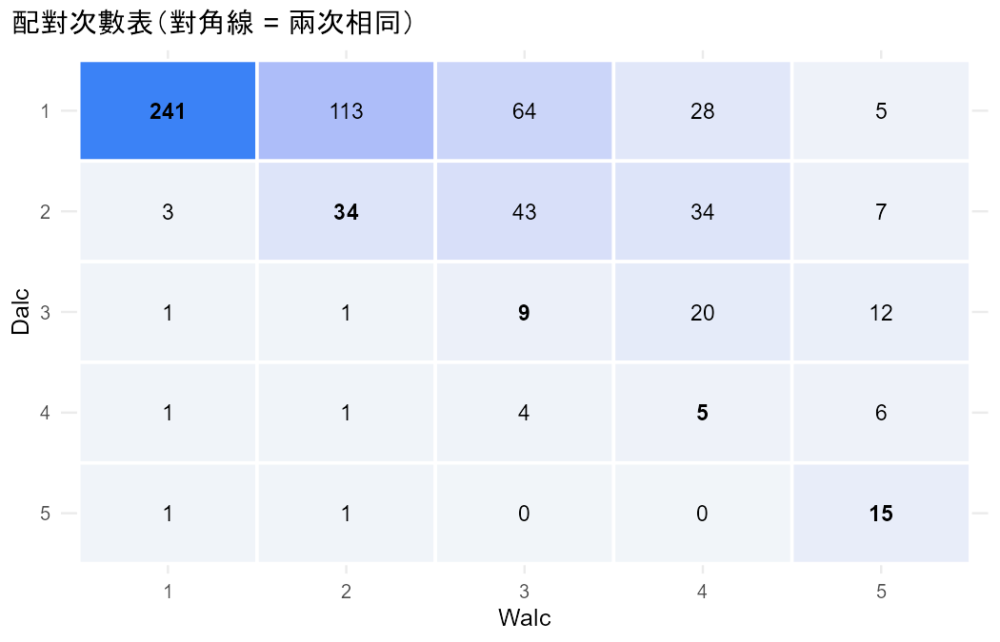
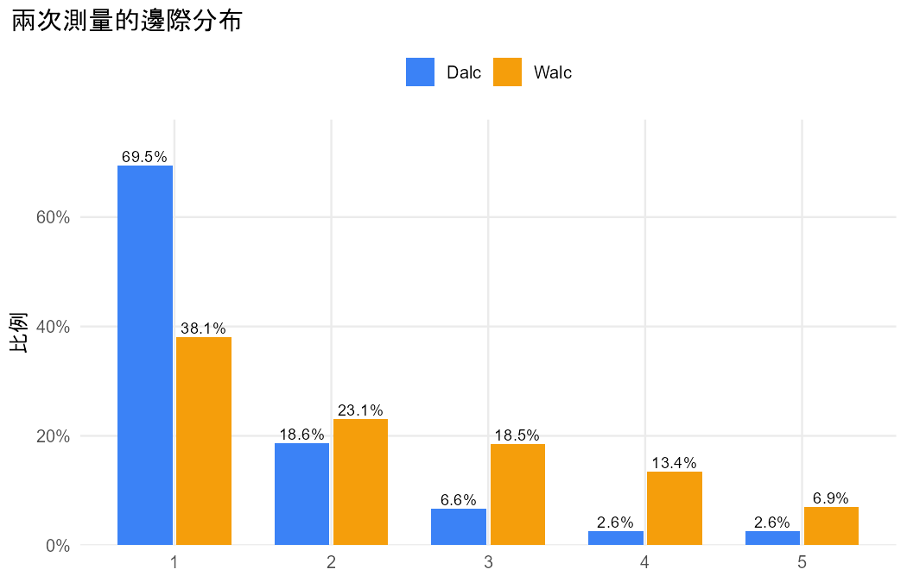

# 分析報告：學生平日和週末的喝酒程度一樣嗎？

## 結論與解釋

### 1. 一句話結論

不一樣。有證據顯示，學生**週末的喝酒程度比平日高**（累積 logit 邊際模型 Wald z² = 322.04，df = 1，P < 0.001）。

### 2. 效果的大小與方向

- **整體來說**，平日（Dalc）落在較高喝酒程度的勝算，是週末（Walc）的 **0.254 倍**（95% 信賴區間 0.219 到 0.295）。換個方向說，週末落在較高程度的勝算約是平日的 **3.939 倍**（95% CI 3.391 到 4.575，這個倒數也由 R 計算）。這是勝算的倍數，不是機率的倍數。依比例勝算假設，不論切點設在「1 vs 2 以上」還是「4 以下 vs 5」，這個倍數都一樣。
- 這是**整體（邊際）層次**的比較：比較的是全體學生平日和週末的分布，不是每一位學生的改變幅度。
- **描述**：程度 1（很少）的學生，平日佔 69.5%，週末只佔 38.1%；程度 4–5 的學生，平日各佔 2.6%，週末分別佔 13.4% 和 6.9%。平均分數平日 1.50、週末 2.28（分數 1–5，只用來輔助描述方向）。
- **逐人來看**：649 人中，有 332 人（51.2%）週末程度高於平日，13 人（2.0%）低於平日，304 人兩者相同。
- **輔助分析**：有序準對稱模型 β̂ = 2.192，和對稱模型比較 LR = 338.71（df = 1），P < 0.001。方向相同，也支持兩者分布不同。

### 3. 注意事項

- R 沒有發出任何警告；資料沒有缺失，649 人全部用到。
- **比例勝算假設**（§8.4.1）：模型假設每個切點的效果相同，第一版沒有做正式檢定。從邊際比例看，差異集中在「1」和「3–4」；如果在意這個假設，可以再用名目方法（§8.3）對照。
- 這是觀察性資料，所以只能說平日和週末的程度「不同」「週末比較高」，不能做因果解釋。另外，Dalc 和 Walc 都是學生自評的 1–5 量表。

### 4. 限制與下一步

- 這裡只比較兩題的分布。如果想知道哪些學生週末喝得比平日多（例如和性別、外出頻率 goout 的關聯），要把資料轉成長格式，用有序 GEE（`gee_ordinal`，§9.3）放進解釋變數。
- 如果想要個體層次的效果（「對同一位學生……」），有序 GLMM 不在第一版的範圍內（§10.3）。

- 資料檔：`student_por.csv`
- 方法：Cumulative logit marginal model for ordinal matched pairs（Agresti §8.4）
- 資料結構：paired
- 選擇理由：同一位學生回答平日（Dalc）與週末（Walc）兩題，類別相同的有序 1–5 量表，只比較兩者分布、沒有解釋變數；有序方法 df = 1 檢定力較高（§8.4）

## 配對次數表

列 = 第一次、欄 = 第二次。

|   | 1 | 2 | 3 | 4 | 5 |
|---|---|---|---|---|---|
| 1 | 241 | 113 | 64 | 28 | 5 |
| 2 | 3 | 34 | 43 | 34 | 7 |
| 3 | 1 | 1 | 9 | 20 | 12 |
| 4 | 1 | 1 | 4 | 5 | 6 |
| 5 | 1 | 1 | 0 | 0 | 15 |

## 描述統計

| category | Dalc_count | Dalc_prop | Walc_count | Walc_prop |
|---|---|---|---|---|
| 1 | 451 | 0.6949 | 247 | 0.3806 |
| 2 | 121 | 0.1864 | 150 | 0.2311 |
| 3 | 43 | 0.0663 | 120 | 0.1849 |
| 4 | 17 | 0.0262 | 87 | 0.1341 |
| 5 | 17 | 0.0262 | 45 | 0.0693 |

## 結果

- 共 649 人，每人兩次測量（Dalc、Walc），類別：1、2、3、4、5。
- 累積 logit 邊際模型（GEE）：β̂ = 1.371（robust SE 0.076），Wald z = 17.95，P < 0.001。
- Dalc 落在較高類別的勝算是 Walc 的 0.254 倍（95% 信賴區間 0.219 到 0.295），對每個切點都相同（比例勝算）。
- 方向：Dalc 傾向落在較低的類別（較接近「1」）。
- 對照：有序準對稱模型 β̂ = 2.192，和對稱模型比較 LR = 338.71（df = 1），P < 0.001；平均分數 Dalc = 1.50、Walc = 2.28（分數 1, 2, 3, 4, 5）。

## 檢定

| test | statistic | df | p_value | book_ref |
|---|---|---|---|---|
| Cumulative logit marginal model (GEE), Wald z^2 | 322.0378 | 1 | 5.212e-72 | §8.4.2 |
| Ordinal quasi-symmetry vs symmetry LR | 338.7055 | 1 | 1.221e-75 | §8.4.3 |

## 估計值

| measure | estimate | se | lower | upper | book_ref |
|---|---|---|---|---|---|
| beta: cumulative logit, first vs second (logit P(Y <= j)) | 1.3708 | 0.0764 | 1.2211 | 1.5206 | §8.4.1 |
| Odds ratio: Dalc in a higher category vs Walc | 0.2539 | — | 0.2186 | 0.2949 | §8.4.1 |
| Ordinal quasi-symmetry beta | 2.1923 | 0.2081 | — | — | §8.4.3 |
| Mean score Dalc | 1.5023 | — | — | — | §8.4.3 |
| Mean score Walc | 2.2804 | — | — | — | §8.4.3 |

## 圖

> 比例勝算：模型假設每個切點的效果相同（§8.4.1）。平均分數取決於分數設定，只用來幫助描述方向。
