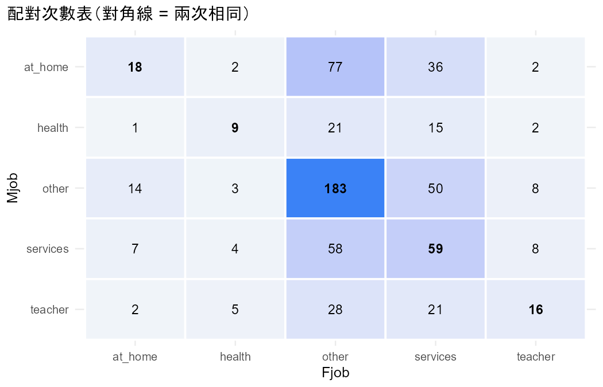
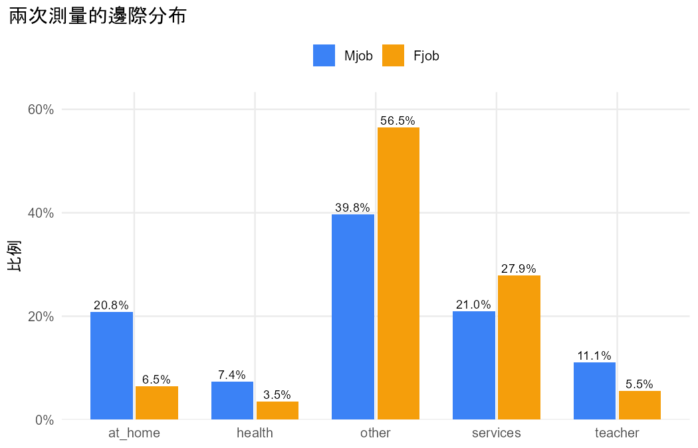

# 分析報告：媽媽和爸爸的職業分布不同嗎？

## 結論與解釋

### 一句話結論

有證據顯示，這 649 位學生的媽媽職業分布和爸爸職業分布不同（邊際同質性 LR = 108.45，df = 4，P < 0.001；CMH = 99.80，df = 4，P < 0.001，結論相同）。

### 差異的大小與方向（整體層次）

以下的比例差是**整體層次**的比較，也就是全部 649 個家庭裡「媽媽是這一類」的比例減去「爸爸是這一類」的比例：

| 職業 | 媽媽 | 爸爸 | 差（媽 − 爸） | 媽是、爸不是（n12） | 爸是、媽不是（n21） |
|---|---|---|---|---|---|
| at_home | 0.208 | 0.065 | +0.143 | 117 | 24 |
| health | 0.074 | 0.035 | +0.039 | 39 | 14 |
| other | 0.398 | 0.565 | −0.168 | 75 | 184 |
| services | 0.210 | 0.279 | −0.069 | 77 | 122 |
| teacher | 0.111 | 0.055 | +0.055 | 56 | 20 |

- 媽媽是 **at_home（在家）** 的比例明顯比較高（差 0.143）：在「只有其中一位在家」的 141 個家庭裡，117 個是媽媽在家，24 個是爸爸在家。
- 媽媽是 **teacher**、**health** 的比例也比較高（差 0.055、0.039）。
- 爸爸是 **other**（差 −0.168）和 **services**（差 −0.069）的比例比較高。
- 逐類別的 McNemar 追蹤，五類的 P 值都小於 0.01（at_home P < 0.001、health P = 0.0006、other P < 0.001、services P = 0.0014、teacher P < 0.001）。

從配對表的標準化殘差來看，最不對稱的是「媽媽 at_home、爸爸 other」（77 戶）對比「媽媽 other、爸爸 at_home」（14 戶），殘差是 6.60。其次是 at_home 對 services（36 vs 7，殘差 4.42）。

補充：準對稱模型配適良好（deviance = 3.00，df = 6，P = 0.81）。對稱模型則配適很差（deviance = 111.46，df = 10，P < 0.001）。意思是，兩個職業分布之間的差異，主要可以用「媽媽和爸爸的邊際分布不同」來解釋（§8.3.4）。

### 注意事項

- 這次分析沒有出現任何警告。對角線以外沒有空的類別配對，也沒有缺失，649 戶全部用上。
- 逐類別的追蹤檢定沒有做多重比較校正，只用來描述哪些類別不同。整體結論以邊際同質性檢定為準（§8.3.2）。
- R 輸出沒有提供各類別比例差的信賴區間，所以這裡只報告點估計和 P 值。
- 這是觀察性資料，只能說兩者的分布「不同」、某一方「比例比較高」，不能推論性別造成了職業差異。

### 限制與下一步

- **other** 是最大的一類（媽媽 39.8%、爸爸 56.5%），而且內容不明確，可能混合了很多不同的職業。爸爸在這一類比例較高，有一部分可能只是因為分類太粗。
- 如果想知道的是「媽媽和爸爸的職業**有沒有關聯**」（例如媽媽是老師時，爸爸是不是也比較常是老師），那是另一個問題，可以用 Part 1（categorical-association）做。
- 這份資料只涵蓋就讀這兩所學校的學生家庭，結論只適用於這個樣本，不代表一般人口。

- 資料檔：`student_por.csv`
- 方法：Marginal homogeneity for nominal matched pairs（Agresti §8.3）
- 資料結構：matched_pairs
- 選擇理由：同一位學生的媽媽職業與爸爸職業是配對的名目結果（5 類，方陣），只比較兩者的邊際分布，沒有其他解釋變數（§8.3）

## 配對次數表

列 = 第一次、欄 = 第二次。

|   | at_home | health | other | services | teacher |
|---|---|---|---|---|---|
| at_home | 18 | 2 | 77 | 36 | 2 |
| health | 1 | 9 | 21 | 15 | 2 |
| other | 14 | 3 | 183 | 50 | 8 |
| services | 7 | 4 | 58 | 59 | 8 |
| teacher | 2 | 5 | 28 | 21 | 16 |

## 描述統計

| category | Mjob_count | Mjob_prop | Fjob_count | Fjob_prop |
|---|---|---|---|---|
| at_home | 135 | 0.2080 | 42 | 0.0647 |
| health | 48 | 0.0740 | 23 | 0.0354 |
| other | 258 | 0.3975 | 367 | 0.5655 |
| services | 136 | 0.2096 | 181 | 0.2789 |
| teacher | 72 | 0.1109 | 36 | 0.0555 |

## 結果

- 共 649 人，每人兩次測量（Mjob、Fjob），類別：at_home、health、other、services、teacher。
- 邊際同質性檢定（對稱 vs 準對稱模型）：LR = 108.45（df = 4），P < 0.001。
- 對照：CMH 檢定 = 99.80（df = 4），P < 0.001。
- 各類別的比例（Mjob → Fjob）：at_home 0.208 → 0.065；health 0.074 → 0.035；other 0.398 → 0.565；services 0.210 → 0.279；teacher 0.111 → 0.055。
- 改變方向明顯不對稱的類別配對（|標準化殘差| > 2）：at_home → other vs other → at_home（6.60）；at_home → services vs services → at_home（4.42）；health → other vs other → health（3.67）；health → services vs services → health（2.52）；other → teacher vs teacher → other（-3.33）；services → teacher vs teacher → services（-2.41）。

## 檢定

| test | statistic | df | p_value | book_ref |
|---|---|---|---|---|
| Marginal homogeneity: symmetry vs quasi-symmetry LR | 108.4544 | 4 | 1.554e-22 | §8.3.4 |
| Symmetry model deviance (fit) | 111.4578 | 10 | 2.711e-19 | §8.3.4 |
| Quasi-symmetry model deviance (fit) | 3.0034 | 6 | 0.8084 | §8.3.4 |
| CMH (score test of marginal homogeneity) | 99.7954 | 4 | 1.087e-20 | §8.3.3 |

## 估計值

| category | prop_1 | prop_2 | difference | n12 | n21 | z | p_value |
|---|---|---|---|---|---|---|---|
| at_home | 0.2080 | 0.0647 | 0.1433 | 117 | 24 | 7.8320 | 4.801e-15 |
| health | 0.0740 | 0.0354 | 0.0385 | 39 | 14 | 3.4340 | 5.947e-04 |
| other | 0.3975 | 0.5655 | -0.1680 | 75 | 184 | -6.7729 | 1.262e-11 |
| services | 0.2096 | 0.2789 | -0.0693 | 77 | 122 | -3.1900 | 0.0014 |
| teacher | 0.1109 | 0.0555 | 0.0555 | 56 | 20 | 4.1295 | 3.636e-05 |

## 圖

> 逐類別的追蹤檢定（estimates）沒有做多重比較校正，只用來描述哪些類別改變；整體結論以邊際同質性檢定為準（§8.3.2）。
