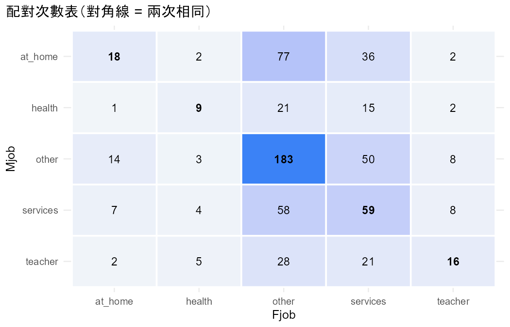
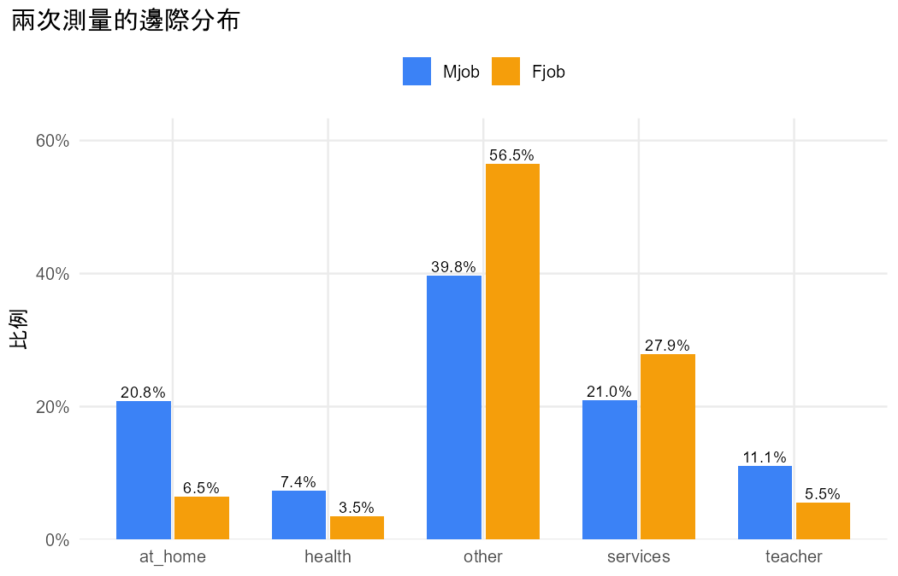

# 初步檢視：student_por.csv

問題：媽媽和爸爸的職業分布不同嗎？

## 重點數字

- 共 649 人，每人兩次測量（Mjob、Fjob），類別：at_home、health、other、services、teacher。
- 兩次回答相同（對角線）的有 285 人（43.9%）。

## 表

### counts

|   | at_home | health | other | services | teacher |
|---|---|---|---|---|---|
| at_home | 18 | 2 | 77 | 36 | 2 |
| health | 1 | 9 | 21 | 15 | 2 |
| other | 14 | 3 | 183 | 50 | 8 |
| services | 7 | 4 | 58 | 59 | 8 |
| teacher | 2 | 5 | 28 | 21 | 16 |

### marginal

| category | Mjob_count | Mjob_prop | Fjob_count | Fjob_prop |
|---|---|---|---|---|
| at_home | 135 | 0.2080 | 42 | 0.0647 |
| health | 48 | 0.0740 | 23 | 0.0354 |
| other | 258 | 0.3975 | 367 | 0.5655 |
| services | 136 | 0.2096 | 181 | 0.2789 |
| teacher | 72 | 0.1109 | 36 | 0.0555 |

## 圖

