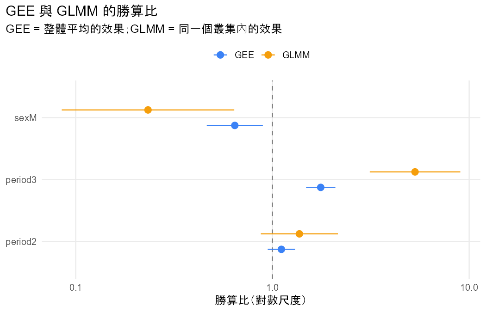

# 分析報告：三次考試的及格率有變化嗎？和性別有關嗎？

## 結論與解釋

### 一句話結論

有證據顯示三次考試的及格率有變化，主要是第 3 次（G3）比第 1 次高；第 2 次和第 1 次的差異證據不足。另外也有證據顯示及格與性別有關聯：控制考試次數後，男生的及格勝算比女生低。GEE 和 GLMM 的結論方向一致。

### 效果的大小與方向

及格是指 G ≥ 10。參考組是第 1 次考試、女生。

**整體來說（GEE，邊際 logistic，exchangeable，robust SE；估計相關 0.651）**

- 時間的整體檢定：Wald = 47.85（df = 2），P < 0.001。
- 第 2 次和第 1 次：勝算比 1.110（95% CI 0.946 到 1.303），P = 0.200。證據不足，無法確定兩次有差異；信賴區間同時涵蓋略降與上升約三成。
- 第 3 次和第 1 次：整體來說，第 3 次及格的勝算是第 1 次的 1.759 倍（95% CI 1.482 到 2.089），P < 0.001。
- 性別：整體來說，男生及格的勝算是女生的 0.644 倍（95% CI 0.464 到 0.894），P = 0.009。
- 描述性的及格比例：第 1、2、3 次分別是 0.7581、0.7766、0.8459。

**對同一位學生（GLMM，隨機截距 logistic，100 點 adaptive Gauss–Hermite）**

- 時間：LR = 49.56（df = 2），P < 0.001。
- 第 2 次和第 1 次：勝算比 1.370（95% CI 0.873 到 2.152），P = 0.171。證據不足。
- 第 3 次和第 1 次：對同一位學生，第 3 次及格的勝算是第 1 次的 5.306 倍（95% CI 3.124 到 9.015），P < 0.001。
- 性別：兩位隨機效果相同（也就是基本程度相同）的學生中，男生及格的勝算是女生的 0.233 倍（95% CI 0.085 到 0.640）。LR = 8.43，P = 0.004。
- 隨機效果標準差 σ̂ = 4.844。σ = 0 的 LR 檢定 = 526.74，P < 0.001（χ²₁ 右尾的一半）。這表示學生之間的基本及格傾向差異非常大。

**兩者並排**

- 兩個模型的方向完全一致：第 3 次較高，男生較低。
- GLMM 的係數大約是 GEE 的 3 倍（period3 是 2.95 倍，sexM 是 3.31 倍）。
- 這是因為兩者回答不同的問題，不是其中一個算錯。81.8% 的學生三次結果都相同，σ̂ = 4.844 很大。在邏輯連結下，個體差異越大，整體平均的效果就越接近 0，所以 GEE 的勝算比比較接近 1（§10.1.4、§10.2.3）。
- 如果你關心的是「全體學生的及格比例」，看 GEE；如果關心的是「同一位學生從第 1 次到第 3 次」的變化，看 GLMM。性別是學生之間的變數，比較適合用 GEE 的整體效果來描述（§10.2.5）。

### 注意事項

- **QUADRATURE_UNSTABLE（§10.1.5）**：50 點和 100 點的 σ̂ 分別是 4.829 和 4.844，差異超過門檻。所以採用 100 點的結果。σ 很大的時候積分比較難近似，GLMM 的數字最好看小數第二位就好；結論方向不受影響。
- **ALL_SAME_RESPONSE（§10.1.4、§10.2.3）**：81.8% 的學生三次結果都相同。這就是 GLMM 效果與 SE 都比 GEE 大的原因，不是錯誤。
- **叢集數提醒（§9.2.4）**：GEE 的 robust SE 是大樣本方法，叢集少的時候會傾向低估。本資料有 649 位學生，課本沒有給門檻，是否足夠請自行判斷。
- **切點**：把 0–20 的分數用 10 分切成及格／不及格，會損失資訊，結論也可能隨切點改變。
- **觀察性資料**：性別與及格「有關聯」，不能說性別「造成」及格與否。

### 限制與下一步

- 可以加入交互作用 `period:sex`，看男女的及格率變化趨勢是否不同。
- 可以把 `period` 改成數值，檢定線性趨勢。
- 想用完整的分數，而不只看及格與否，需要連續結果的方法（線性混合模型），不在本 Skill 範圍內。

- 資料檔：`student_por.csv`
- 方法：GEE (population-averaged) vs GLMM (subject-specific)（Agresti §10.1.4, §10.2.5）
- 資料結構：repeated
- 選擇理由：同一位學生三次考試的二元結果；時間是叢集內變數、性別是叢集間變數，使用者兩種效果都想知道（§9.2、§10.2）

## 描述統計

| time | n | successes | proportion |
|---|---|---|---|
| 1 | 649 | 492 | 0.7581 |
| 2 | 649 | 504 | 0.7766 |
| 3 | 649 | 549 | 0.8459 |

## 結果

- 資料沒有 id 欄，依列號產生 id（1–649），每一列視為一個叢集。
- 把 G1、G2、G3 轉成長格式：G 欄為測量值，period 欄為時間（1 = G1、2 = G2、3 = G3），共 1947 列。
- 新變數 passed 由 G 轉換：< 10 → fail；≥ 10 → pass。
- 提醒：把連續的 G 切成類別會損失資訊，結論可能隨切點改變。
- 同一份資料（649 個叢集、1947 筆）分別配適 GEE（整體平均）與 GLMM（同一個叢集）。
- period2：GEE 估計 0.105（SE 0.082）、GLMM 估計 0.315（SE 0.230），GLMM / GEE = 3.01。
- period3：GEE 估計 0.565（SE 0.088）、GLMM 估計 1.669（SE 0.270），GLMM / GEE = 2.95。
- sexM：GEE 估計 -0.441（SE 0.167）、GLMM 估計 -1.457（SE 0.515），GLMM / GEE = 3.31。
- GLMM 的隨機效果標準差 σ̂ = 4.844；GEE 的 working correlation 估計 = 0.651。
- 兩者回答不同的問題：GEE 是母體中隨機抽的人的平均效果，GLMM 是固定同一個叢集時的效果；邏輯連結下，σ 越大，整體平均的效果越接近 0（§10.1.4）。

## 檢定

| test | statistic | df | p_value | book_ref |
|---|---|---|---|---|
| Wald (robust SE): period | 47.8485 | 2 | 4.072e-11 | §9.2.4 |
| Wald (robust SE): sex | 6.9235 | 1 | 0.0085 | §9.2.4 |
| Likelihood-ratio: period | 49.5554 | 2 | 1.735e-11 | §10.1.6 |
| Likelihood-ratio: sex | 8.4350 | 1 | 0.0037 | §10.1.6 |
| Random effect sigma = 0 (LR, half chi-squared) | 526.7444 | 1 | 7.214e-117 | §10.1.6 |

## 估計值

| term | gee_estimate | gee_se | glmm_estimate | glmm_se | ratio | gee_or | glmm_or |
|---|---|---|---|---|---|---|---|
| (Intercept) | 1.3348 | 0.1232 | 4.2308 | 0.4936 | 3.1695 | 3.7994 | 68.7689 |
| period2 | 0.1045 | 0.0816 | 0.3150 | 0.2302 | 3.0139 | 1.1102 | 1.3702 |
| period3 | 0.5650 | 0.0875 | 1.6689 | 0.2704 | 2.9540 | 1.7594 | 5.3064 |
| sexM | -0.4406 | 0.1675 | -1.4566 | 0.5151 | 3.3058 | 0.6436 | 0.2330 |

## 注意事項

- **QUADRATURE_UNSTABLE**：用 50 點和 100 點配適的估計值差異超過 0.0005（σ̂：4.829 vs 4.844），數值積分可能還沒穩定；以下報告 100 點的結果。（Agresti §10.1.5）
- **ALL_SAME_RESPONSE**：有 81.8% 的叢集所有回答都相同，σ̂ = 4.844：叢集之間差異越大，GLMM（同一個叢集）的效果就比 GEE（整體平均）大越多，SE 也一樣變大。這不是錯誤。（Agresti §10.1.4、§10.2.3）

## 圖

> 兩個模型的數字不同不代表其中一個算錯；結論通常相同（§10.2.3）。
