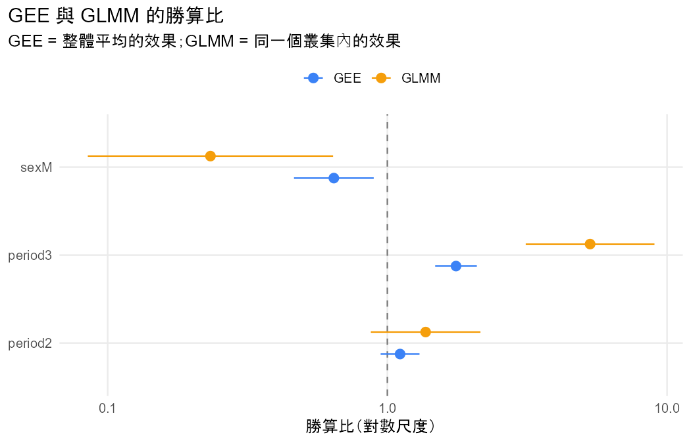

# 分析報告：三次考試的及格率有變化嗎？和性別有關嗎？

## 結論與解釋

### 一句話結論

有證據顯示三次考試的及格率有變化（主要是第 3 次比第 1 次高），也有證據顯示及格和性別有關（女生比男生容易及格）；GEE（整體平均）和 GLMM（同一位學生）兩種模型的方向一致。

### 效果的大小與方向

**考試次數**（period 整體檢定：GEE robust Wald = 47.85，df = 2，P < 0.001；GLMM LR = 49.56，df = 2，P < 0.001）

- 及格比例：第 1 次 0.7581、第 2 次 0.7766、第 3 次 0.8459。
- 第 2 次 vs 第 1 次：
  - 整體來說（GEE），勝算比 = 1.110（95% CI 0.946 到 1.303），P = 0.200。
  - 對同一位學生（GLMM），勝算比 = 1.370（95% CI 0.873 到 2.152），P = 0.171。
  - 證據不足，無法確定第 2 次和第 1 次的及格勝算是否不同；信賴區間同時包含小幅下降和明顯上升。
- 第 3 次 vs 第 1 次：
  - 整體來說（GEE），第 3 次及格的勝算是第 1 次的 1.759 倍（95% CI 1.482 到 2.089），P < 0.001。
  - 對同一位學生（GLMM），第 3 次及格的勝算是第 1 次的 5.306 倍（95% CI 3.124 到 9.015），P < 0.001。
- 第 3 次 vs 第 2 次的直接比較，這次的輸出沒有提供。

**性別**（GEE robust Wald = 6.92，df = 1，P = 0.009；GLMM LR = 8.43，df = 1，P = 0.004）

- 及格比例：女生三次分別是 0.7885、0.8120、0.8695，男生是 0.7143、0.7256、0.8120。
- 整體來說（GEE），女生及格的勝算是男生的 1.554 倍（95% CI 1.119 到 2.157）。反過來說，男生的勝算是女生的 0.644 倍（95% CI 0.464 到 0.894）。
- 對同一位學生（GLMM），也就是隨機效果相同、其他條件相同時，女生及格的勝算是男生的 4.291 倍（95% CI 1.564 到 11.778）。反過來說，男生是女生的 0.233 倍（95% CI 0.085 到 0.640）。這個信賴區間很寬。
- 這是觀察性資料，只能說性別和及格「有關聯」，不能說性別造成及格與否。

**GEE 與 GLMM 為什麼差約 3 倍**

- 兩種模型的方向一致；GLMM 的係數大約是 GEE 的 2.95 到 3.31 倍。
- 這兩個模型回答的是不同的問題，數字不同不代表哪一個算錯：
  - GEE 回答的是「整體來說，在學生母體中平均的差別」。
  - GLMM 回答的是「固定同一位學生時的差別」。
- 學生之間的差異非常大：隨機效果標準差 σ̂ = 4.844，σ = 0 的 LR 檢定 P < 0.001；有 81.8% 的學生三次考試結果完全相同；GEE 估計的 working correlation 是 0.651。在 logit 連結下，個體差異越大，整體平均的效果就越接近 0，所以 GLMM 的勝算比比較大，SE 也比較大（§10.1.4、§10.2.3）。

### 注意事項

- **QUADRATURE_UNSTABLE**（§10.1.5）：用 50 點和 100 點數值積分配適 GLMM 時，兩者的估計值差異超過 0.0005（σ̂：4.829 vs 4.844），所以採用點數較多（100 點）的結果。
- **ALL_SAME_RESPONSE**（§10.1.4、§10.2.3）：81.8% 的學生三次結果完全相同，這就是 GLMM 效果與 SE 都比 GEE 大的原因，不是錯誤。
- **GEE 的 SE**：表中 GEE 的 SE 都是 robust（sandwich）SE，即使 working correlation 設錯也有效（§9.2.2）。robust SE 是大樣本方法，叢集少時傾向低估（§9.2.4）。本資料有 649 個叢集；課本沒有給「多少叢集才夠」的門檻，請自行判斷。
- **切點**：及格是把 0–19 分在 10 分處切成兩類，會損失分數本身的資訊，換其他門檻時結論可能不同。
- **沒有缺失**：每位學生三次考試都有成績，所以不需要考慮缺失機制（§9.5.1）。

### 限制與下一步

- 模型沒有放 period × sex 交互作用，所以假設男女的及格率隨考試次數的變化幅度相同（在 logit 尺度上）。若想知道男女的變化是否不同，可以加入 `period:sex` 再分析。
- 想直接比較第 3 次和第 2 次，可以把 period 的參考組改成 2 重新配適。
- 這次只放了性別一個解釋變數，結果沒有控制學校、讀書時間等其他變數。

- 資料檔：`student_por.csv`
- 方法：GEE (population-averaged) vs GLMM (subject-specific)（Agresti §10.1.4, §10.2.5）
- 資料結構：repeated
- 選擇理由：同一位學生三次考試的二元結果；時間是叢集內變數、性別是叢集間變數，使用者同意兩種效果並排（§9.2、§10.2）

## 描述統計

| time | n | successes | proportion |
|---|---|---|---|
| 1 | 649 | 492 | 0.7581 |
| 2 | 649 | 504 | 0.7766 |
| 3 | 649 | 549 | 0.8459 |

## 結果

- 資料沒有 id 欄，依列號產生 id（1–649），每一列視為一個叢集。
- 把 G1、G2、G3 轉成長格式：G 欄為測量值，period 欄為時間（1 = G1、2 = G2、3 = G3），共 1947 列。
- 新變數 passed 由 G 轉換：< 10 → fail；≥ 10 → pass。
- 提醒：把連續的 G 切成類別會損失資訊，結論可能隨切點改變。
- 同一份資料（649 個叢集、1947 筆）分別配適 GEE（整體平均）與 GLMM（同一個叢集）。
- period2：GEE 估計 0.105（SE 0.082）、GLMM 估計 0.315（SE 0.230），GLMM / GEE = 3.01。
- period3：GEE 估計 0.565（SE 0.088）、GLMM 估計 1.669（SE 0.270），GLMM / GEE = 2.95。
- sexM：GEE 估計 -0.441（SE 0.167）、GLMM 估計 -1.457（SE 0.515），GLMM / GEE = 3.31。
- GLMM 的隨機效果標準差 σ̂ = 4.844；GEE 的 working correlation 估計 = 0.651。
- 兩者回答不同的問題：GEE 是母體中隨機抽的人的平均效果，GLMM 是固定同一個叢集時的效果；邏輯連結下，σ 越大，整體平均的效果越接近 0（§10.1.4）。

## 檢定

| test | statistic | df | p_value | book_ref |
|---|---|---|---|---|
| Wald (robust SE): period | 47.8485 | 2 | 4.072e-11 | §9.2.4 |
| Wald (robust SE): sex | 6.9235 | 1 | 0.0085 | §9.2.4 |
| Likelihood-ratio: period | 49.5554 | 2 | 1.735e-11 | §10.1.6 |
| Likelihood-ratio: sex | 8.4350 | 1 | 0.0037 | §10.1.6 |
| Random effect sigma = 0 (LR, half chi-squared) | 526.7444 | 1 | 7.214e-117 | §10.1.6 |

## 估計值

| term | gee_estimate | gee_se | glmm_estimate | glmm_se | ratio | gee_or | glmm_or | gee_or_reverse | glmm_or_reverse |
|---|---|---|---|---|---|---|---|---|---|
| (Intercept) | 1.3348 | 0.1232 | 4.2308 | 0.4936 | 3.1695 | 3.7994 | 68.7689 | 0.2632 | 0.0145 |
| period2 | 0.1045 | 0.0816 | 0.3150 | 0.2302 | 3.0139 | 1.1102 | 1.3702 | 0.9008 | 0.7298 |
| period3 | 0.5650 | 0.0875 | 1.6689 | 0.2704 | 2.9540 | 1.7594 | 5.3064 | 0.5684 | 0.1885 |
| sexM | -0.4406 | 0.1675 | -1.4566 | 0.5151 | 3.3058 | 0.6436 | 0.2330 | 1.5537 | 4.2914 |

## 注意事項

- **QUADRATURE_UNSTABLE**：用 50 點和 100 點配適的估計值差異超過 0.0005（σ̂：4.829 vs 4.844），數值積分可能還沒穩定；以下報告 100 點的結果。（Agresti §10.1.5）
- **ALL_SAME_RESPONSE**：有 81.8% 的叢集所有回答都相同，σ̂ = 4.844：叢集之間差異越大，GLMM（同一個叢集）的效果就比 GEE（整體平均）大越多，SE 也一樣變大。這不是錯誤。（Agresti §10.1.4、§10.2.3）

## 圖

> 兩個模型的數字不同不代表其中一個算錯；結論通常相同（§10.2.3）。
